
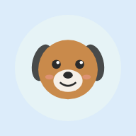

<h1 align="center">Pawse</h1>

<b>Pause the habit. Keep your pet happy.</b>

Pawse is a habit-change app with a pet at its heart. Pick something you want to cut down on, such as late-night food orders, impulse buys, smoking or doomscrolling, and adopt a companion. Every clean day keeps them healthy. Every slip costs them a little life, and the app always shows you the way back.

It's built to feel warm rather than preachy. It's honest about slips, generous about progress, and private by default.

  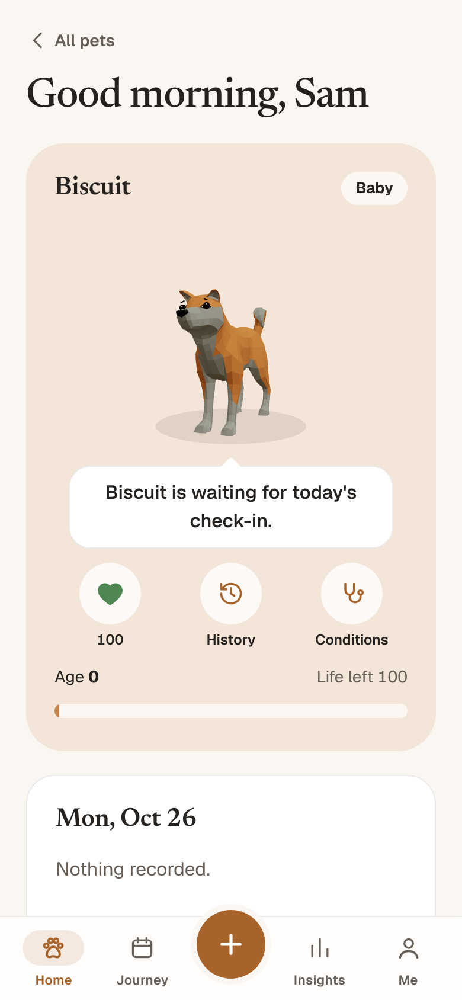
  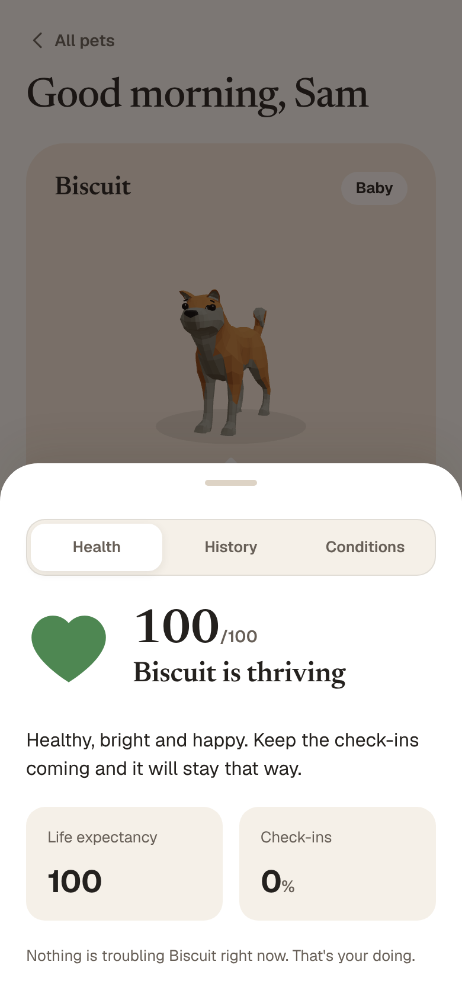
  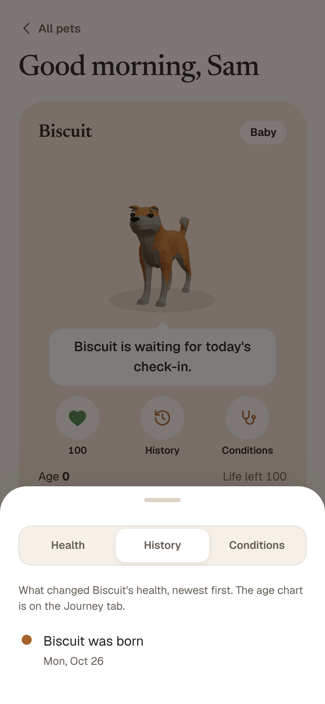

## What it does

**A pet that reflects how things are going**
- Six species: dog, cat, rabbit, fox, owl and panda, each with several coats and one of four personalities (playful, calm, sassy, wise). The dog and the fox are animated in 3D; the others use expressive animated 2D art.
- Personality changes how the pet plays and talks, and you choose how direct it is: Gentle, Honest or Direct.
- Tap the pet to pet it, tickle it or stroke it, and it reacts.

**Health you can understand**
- **Health:** a heart from 0 to 100 with a plain-language summary that praises good care and is straight about slips.
- **History:** the pet's life story, for example "Biscuit lost 3 months of lifespan" or "5 clean days, 6 months of life back".
- **Conditions:** pet ailments that mirror the habit, each with why it happened and how many clean days fix it. A dog gets kennel cough, a cat feline asthma, a rabbit gut slowdown.
- **You & pet:** days together, clean days, best streak, life lost and healed, urges ridden out, check-in rate.

**Fair rules** (all in `packages/engine`, all tested)
- A slip costs a few months of life. More slips in one day cost more.
- A clean day heals 1.5 months. Some damage always stays, so history matters.
- **Hidden reserve:** about two clean months build a cushion, so a one-off slip after a long run doesn't hurt.
- **Binge scar:** three or more slips in one day lower the pet's life expectancy for good.
- **Quiet days:** the pet only heals on days you check in. A quiet day is missing data, not a slip, so it costs nothing; gentle reminders follow. (The engine still has the older "loneliness" rule, switched off by `QUIET_DAYS_AGE` in `src/store.ts`.)
- **The way back:** after every slip you see exactly how many clean days undo it.

**Tools that help in the moment**
- **Urge SOS:** two minutes of paced breathing with your pet when a craving hits. Riding one out counts as a win.
- **Insights:** this week against last, urges ridden out, a map of your risky hours, money kept and a savings goal.
- **Journey:** milestones, streaks, a calendar and a one-line daily reflection.
- **Notes from your pet:** a thank-you after clean days, a heads-up before your usual risky hour, and a check-in reminder.
- **Android home-screen widget** showing your pet and today at a glance.

  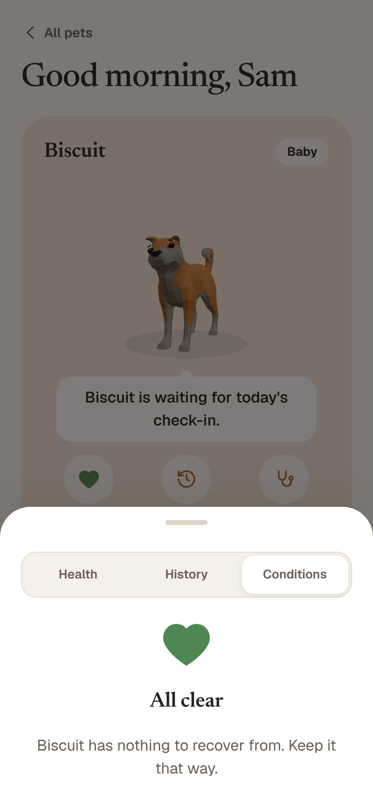
  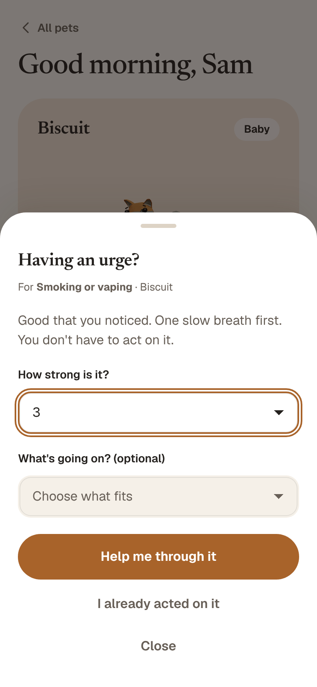
  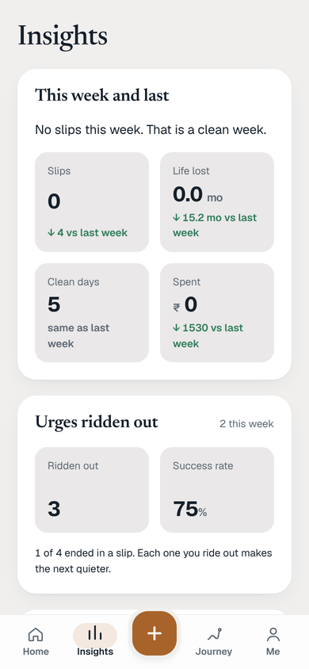
  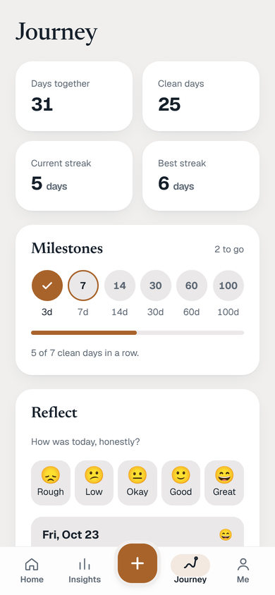

  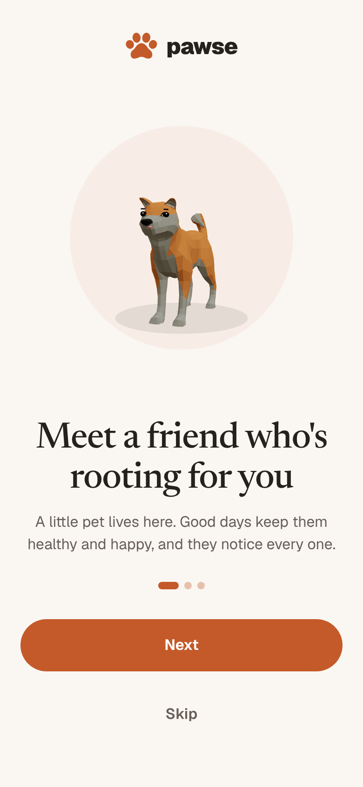
  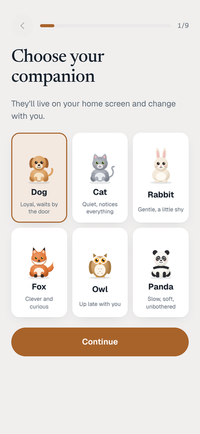
  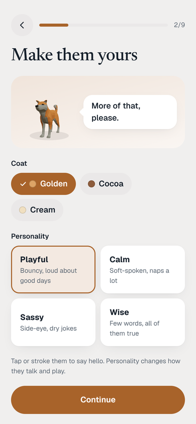
  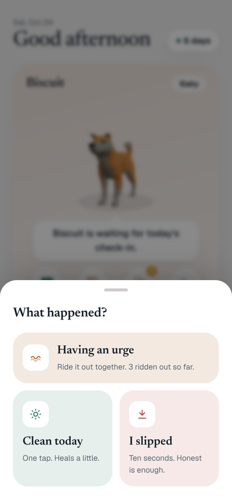
  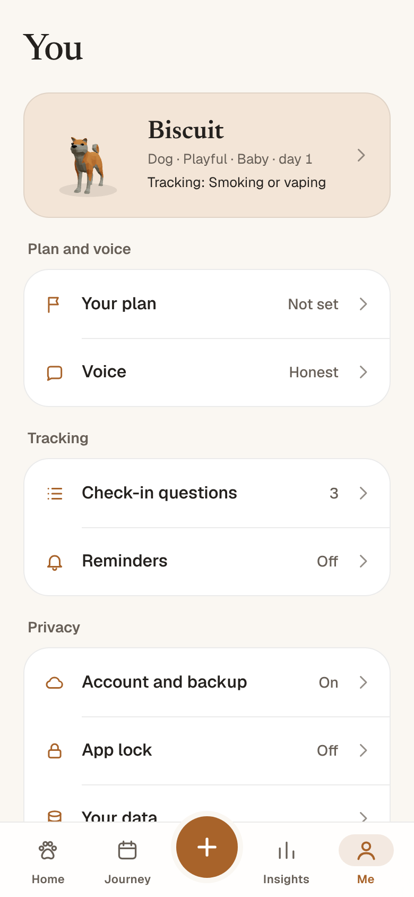

<b>Dark mode</b> 
  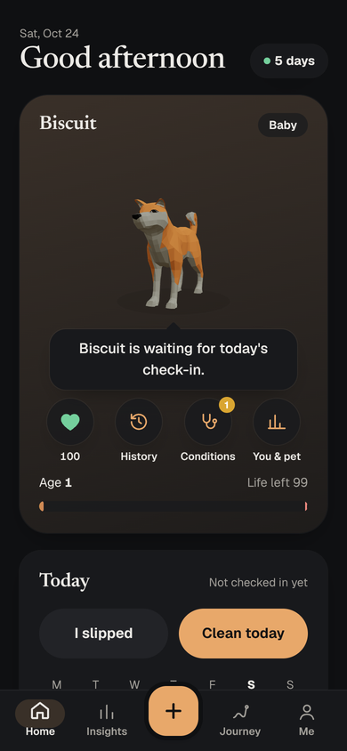
  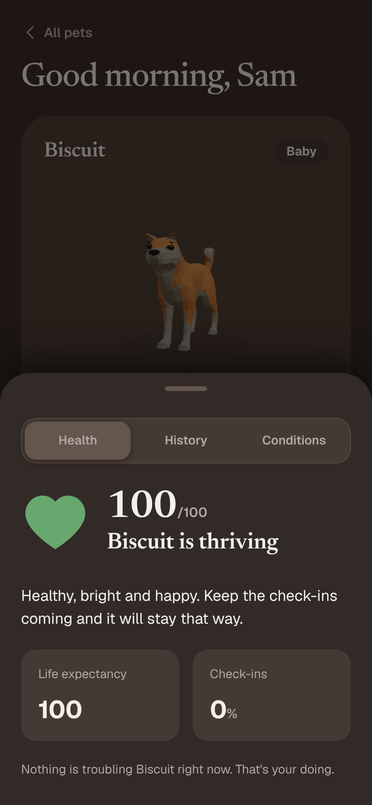
  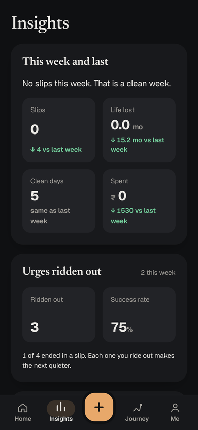
  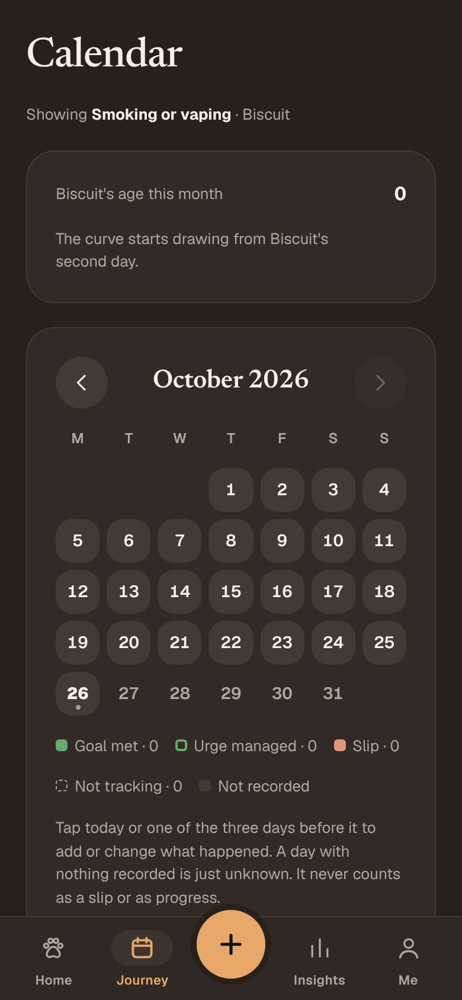

## Privacy and safety

- An account is needed so your pet survives a lost phone. Your data is protected by row-level security, so only you can read it. Photos never leave the phone.
- An optional PIN encrypts everything stored on the phone (PBKDF2 with AES-GCM).
- The AI explanations run through a server function. No AI key ships in the app, and every AI answer is checked and falls back to plain text if anything is off.
- It never tracks calories, weight or restriction. It's a self-awareness tool, not medical advice. Pet conditions are illustrative.
- Your region comes from the phone's time zone, which sets the currency and clock with no location permission. Times always show on a 12-hour clock.

## How it's built

| Part | What it is |
|---|---|
| `apps/web` | React 19 + TypeScript on Vite, wrapped for Android with Capacitor 7 |
| `packages/engine` | The pure ageing maths: deductions, healing, scars, reserve, quiet days |
| `packages/schema` | Zod schemas for everything stored, synced or sent to the AI |
| `supabase` | Postgres tables with row-level security, plus the `ai` edge function (OpenRouter) |
| Animation | `motion` for UI; three.js + React Three Fiber for the 3D pets |

### Open-source pieces and licences

| Dependency | Licence |
|---|---|
| three.js 0.186 | MIT |
| @react-three/fiber 9.8 | MIT |
| motion 12 | MIT |
| React 19, Capacitor 7, Supabase JS, Zod | MIT |
| Geist, Newsreader fonts | SIL Open Font License |

### 3D models

| File | Model | Author | Licence |
|---|---|---|---|
| `public/models/dog.glb` | Shiba Inu | Quaternius | CC0 1.0 |
| `public/models/fox.glb` | Fox | Quaternius | CC0 1.0 |
| `public/models/cat.glb` | Cat (included, not shown) | Quaternius | CC0 1.0 |

Sources and notes are in [`apps/web/public/models/LICENSE.md`](apps/web/public/models/LICENSE.md). The models are rigged with skeletal animation clips (idle, head-low idle, hit react, jump, death) but have no facial rig. Expressions come from body animation and posture, accessories are 2D-only, and cat, rabbit, owl and panda use the 2D art.

## Develop

    pnpm install
    pnpm dev          # the app at http://localhost:5173
    pnpm test         # engine, schema and app tests
    pnpm typecheck
    pnpm simulate     # 90-day age curves for light, medium and heavy patterns

Read [`docs/PRD.md`](docs/PRD.md) first: it is the source of truth for the product and the engine rules.

### Android release APK

    # 1. Bump apps/web/version.json (the code must go up every release)
    # 2. Put the signing key in apps/web/android/keystore/ (not in git; see the README there)
    pnpm --filter web build
    cd apps/web && npx cap sync android
    cd android && ANDROID_HOME=/path/to/sdk ./gradlew assembleRelease
    # -> apps/web/android/app/build/outputs/apk/release/app-release.apk

Requires Java 21 and Android SDK 35.

### Database

Run the migrations in `supabase/migrations` in order (0001, 0002, 0003). Each one is additive and safe to re-run. See `supabase/README.md` for the AI function and its secret.

### Where things live

- `src/Companion.tsx`: the 2D pet art and live behaviour. `src/Pet3D.tsx`: the 3D pet.
- `src/health.ts`: the health report, conditions, history and stats. `src/voice.ts`: everything the pet says.
- `src/store.ts`: state, IndexedDB persistence, encryption. `src/sync.ts` and `src/syncmap.ts`: offline-first sync.
- `src/notify.ts`: reminders and pet notes. `src/region.ts`: time zone and currency.
