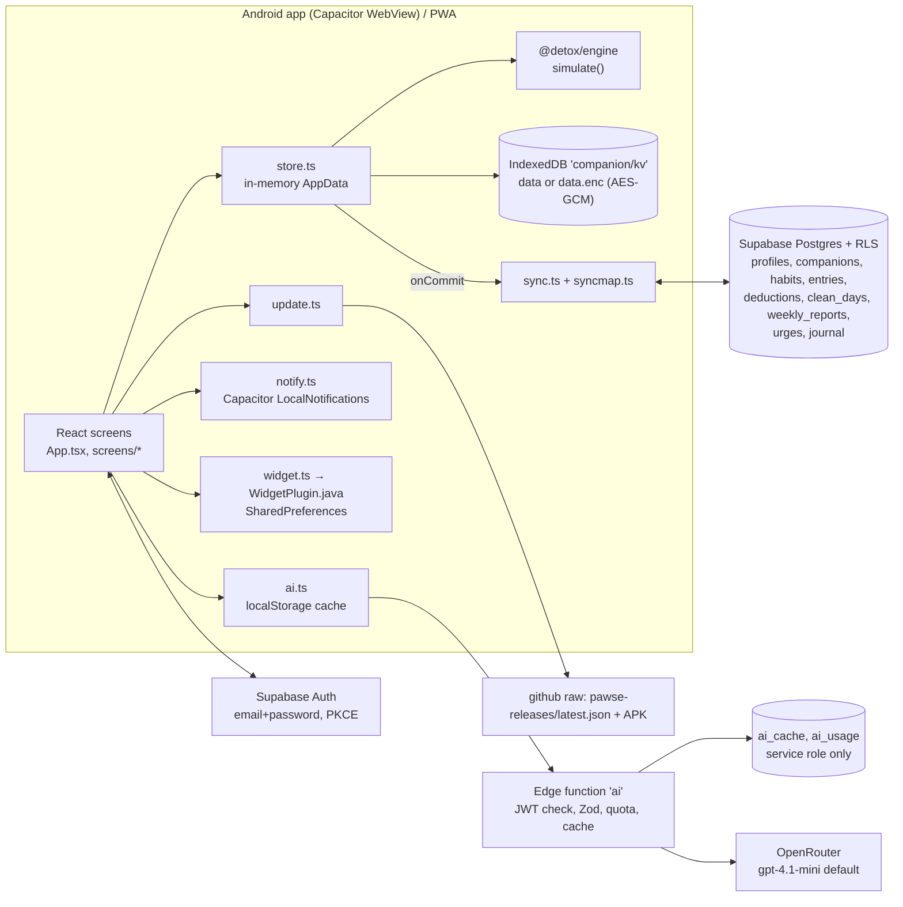
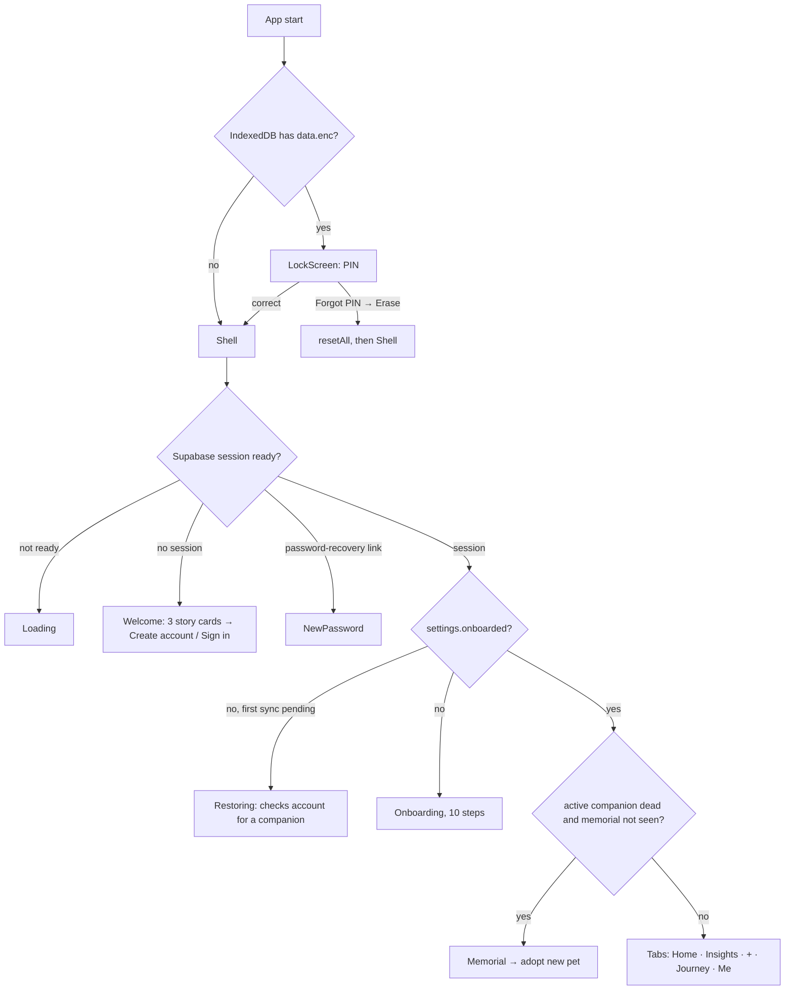
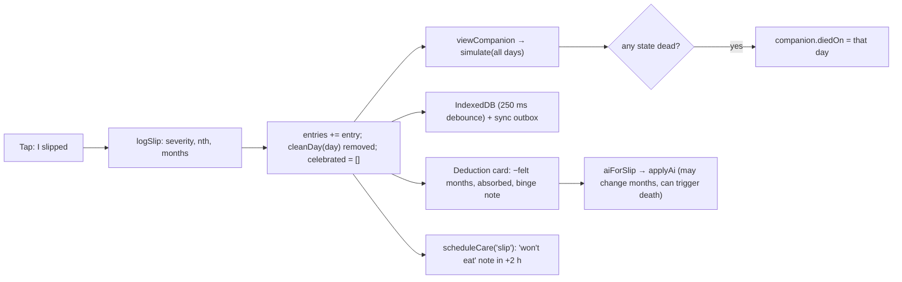

# Pawse: Product and System Audit

Date: 2026-10-24 · Branch audited: `claude/pawse-audit-6h0t1a` (head `40b7072`, same code as `main` plus the audit command) · Companion repo: `jithujsam/pawse-releases` (head `b6172ad`)

This is a read-only audit. No application code, configuration, schema, dependency or existing document was changed. The only file written is this report.

**Evidence labels.** **Verified**: read in source or config, or shown by a check that was run. **Inferred**: the best reading of the evidence, not guaranteed. **Hypothesis**: a product or behavioural idea that needs validation. **Unknown**: can't be established from the repository. **Needs runtime verification**: code reading alone isn't enough.

---

## 1. Executive summary

**What Pawse is today (Verified).** Pawse is an Android app (a Capacitor 7 wrapper around a React 19 + Vite web app; it also runs as a web app/PWA). It helps adults cut down on one self-chosen habit, such as food-delivery spending, impulse buying, doomscrolling, smoking, drinking or gambling. A virtual pet (6 species, 2 of them in 3D) "ages" when the person logs a slip and heals on days they mark clean. If it reaches visible age 100, it dies, a memorial is shown, and the person adopts a new one. You need a Supabase email/password account before you can use the app. The data is stored on the phone in IndexedDB, can be encrypted with a PIN, and syncs to Supabase Postgres tables protected by row-level security. An optional AI layer (an edge function calling OpenRouter, default model `openai/gpt-4.1-mini`) rewrites the explanation after a slip, nudges its cost by ±30%, and writes a weekly summary.

**What kind of product it is (Inferred).** Pawse is a **self-monitoring and loss-framed commitment device for reducing one unwanted behaviour, with a pet as the feedback display**. It isn't a positive habit tracker: there are no schedules, no "do X" goals and no frequency targets. It isn't a pet simulation either: you can't feed the pet, and its stats aren't independent of the habit log. The pet's whole state is a pure function of three inputs: slips logged, days marked clean, and days with nothing logged.

**Maturity (Verified from git history).** All 85 commits on the current product were made on 2026-10-23 and 2026-10-24. The repository was previously a different app ("Beatmap"). Version 2.1.0 (code 7) is published as a sideloaded APK through the public `pawse-releases` repo. I computed the APK's SHA-256 and it matches `latest.json`.

**The five most important findings:**

1. **Confirmed code path, high severity, needs runtime verification: two "this phone only" erase actions can delete the account's cloud data.** "Me → Your data → Delete all data on this phone", and "Forgot PIN → Erase" on the auto-lock screen while sync is running, both call `actions.resetAll()`. That commits a blank dataset as a *local* change. The sync hook (`sync.ts` `onCommit`) turns every removed row into a server soft-delete and pushes `onboarded:false` to the shared profile. The on-screen copy promises the opposite (section 11, B1).
2. **Confirmed: the server AI cache is shared across all users.** `ai_cache` is keyed on coarse features (class, tone, unit, ratio bucket, trigger count, slip number, baseline months, slips this week, pet name), so two users with the default pet name "Biscuit" and similar slips get the same stored sentence. That sentence can quote the first user's facts. The client cache leaves out the pet name and the notes, so it can show another pet's name or stale details (B2).
3. **Confirmed: AI "polish" can cut a big slip's cost by up to 50%, not the stated ±30%.** The deterministic baseline can reach 24 months for one slip (`4 × 3.0 × 2.0`). `applyAiAdjustment` clamps the result to 12. So any accepted AI answer, even `ai_adjust_pct: 0`, halves a 24-month slip. A slip that gets no AI answer keeps the full 24 (B3).
4. **Verified design: missing data is treated as behaviour.** After 2 days with nothing logged, each further day costs 1.5 months ("loneliness"). Healing requires an explicit clean tap. A year of silence from day 1 takes the pet to age ≈45 (simulation run below). "Money kept" counts unlogged days as money saved. And clean days can be marked retroactively on *any* past day, while slips can only be logged for today or yesterday. The system can't tell "didn't do it" from "didn't report it" (sections 7 and 8).
5. **Verified: no monetisation exists.** There's no payment, subscription, entitlement, paywall or pricing code anywhere. Distribution is a sideloaded APK on GitHub, with no app store. The ₹99/month direction is entirely unbuilt (section 13).

**Safe checks run (section 14):** I couldn't run `pnpm test`, `pnpm typecheck` or `pnpm lint` because `node_modules` isn't installed and installing was out of scope. I copied the pure engine to the scratchpad and ran it with Node 22's type stripping. It reproduces `docs/tuning.md` exactly. I verified the APK hash. The live end-to-end test (`apps/web/test/e2e-live.cjs`) creates real accounts on the live project, so I deliberately didn't run it.

---

## 2. Verified stack, runtime, deployment and dependencies

| Layer | What is actually used | Evidence | Label |
|---|---|---|---|
| Package manager | pnpm workspace (`apps/*`, `packages/*`); pnpm 10.28 and Node 22.22 are on this machine | `pnpm-workspace.yaml`, `pnpm-lock.yaml` | Verified |
| Language | TypeScript throughout; Java for the Android widget; SQL (Postgres) | sources | Verified |
| UI framework | React 19.1 with Vite 5.4 (**not** the Next.js + Tailwind the PRD names) | `apps/web/package.json`, `vite.config.ts` | Verified |
| Routing | No router. One `Shell` with 4 tabs held in React state (`App.tsx` `Tab`), plus sheets and sub-pages | `App.tsx` | Verified |
| State | A module-level store with `useSyncExternalStore` (`store.ts` `commit`, `useData`), immutable updates, commit hooks for sync | `store.ts` | Verified |
| Animation | `motion` 12 (gestures, transitions); CSS keyframes; three.js 0.186 + @react-three/fiber 9.8 for 3D pets | `package.json`, `Pet3D.tsx` | Verified |
| Pure engine | `packages/engine`: deductions, healing, scar floor, reserve, neglect, stages, projections. No I/O | `packages/engine/src/*` | Verified |
| Schemas | Zod 3 in `packages/schema` (storage, sync, AI request/response) | `packages/schema/src/*` | Verified |
| Native shell | Capacitor 7 (android, app, haptics, local-notifications). Custom `WidgetPlugin` and `CompanionWidget` in Java. minSdk 23, targetSdk 35 | `apps/web/android/**` | Verified |
| Backend | Supabase: Auth (email + password, PKCE deep links), Postgres + RLS, one Deno edge function `ai` | `supabase/**`, `src/supabase.ts` | Verified |
| AI provider | OpenRouter chat completions; default model `openai/gpt-4.1-mini`, overridable with `AI_MODELS` (up to 3, tried in order). The PRD names Claude Haiku/Sonnet; that isn't what's built | `supabase/functions/ai/index.ts` | Verified |
| Analytics / crash reporting | None found. No analytics SDK, no error reporting service | grep across `apps`, `packages` | Verified |
| CI | None. No `.github/` directory | repo listing | Verified |
| Distribution | Sideloaded APK from `raw.githubusercontent.com/jithujsam/pawse-releases/main/apk/…`; in-app update check reads `latest.json` from that repo | `src/update.ts`, `pawse-releases/latest.json` | Verified |
| Web hosting | A PWA build exists (`public/sw.js`, manifest), but I found no hosting configuration or URL | repo | Unknown |
| Supabase project | A specific project URL and **publishable** (public by design) key are hard-coded as fallbacks in `src/supabase.ts`; env vars override them. Values are not repeated here | `src/supabase.ts` | Verified |
| Live database state | `docs/production-plan.md` says migration 0002 "is tested … but not yet applied to the live project", yet later commits and the live e2e script assume it's applied. Sync code tolerates missing v2 tables (`OPTIONAL_TABLES`) | docs, `sync.ts` | Unknown; needs runtime verification |

**What works locally vs needs external setup (Inferred from code):**
- After `pnpm install`, `pnpm dev`, `pnpm test`, `pnpm typecheck` and `pnpm simulate` should work without network access, but the app itself **can't be used past the Welcome screen without a reachable Supabase project** (`App.tsx`: `if (!session) return <Welcome/>`).
- The AI needs the `ai` function deployed, plus the `OPENROUTER_API_KEY` secret (or the "deploy-time key" fallback, see B19) and migration 0001 (`bump_ai_usage`, `ai_usage`) and 0002 (`ai_cache`).
- Android builds need the Android SDK, Java (the README says 21; CLAUDE.md says 17+), and a signing key that isn't in git.



---

## 3. Product purpose, audience and current promise

| Topic | Source of claim | What the code actually does | Label |
|---|---|---|---|
| Intent | PRD §1–2: "Realization is the intervention"; a calendar-based behaviour tracker where slips age a companion and it can die | Matches the engine and screens | Verified |
| Target user | PRD §4: adults 18+ with a nameable pattern; not people in crisis, minors or those with eating disorders | An 18+ switch in onboarding step 9 plus a line on the account screen; a crisis keyword filter; a restriction-language block (`questions.ts isRestrictionRelated`) | Verified (self-declared gate only) |
| Primary outcome | PRD §13: fewer slips or less spend by week 4 vs week 1 | No in-app outcome measurement beyond week-vs-week deltas and a "since you started" self-reported baseline comparison | Verified |
| Current promise (README) | "Pause the habit. Keep your pet happy." Fair rules, the way back, private by default | Mostly matches. Caveats in sections 10–11 | Verified |
| Monetisation | PRD §17.6 lists pricing as an open question | None implemented | Verified |
| What a user can actually do | Create an account, onboard one habit and one pet, log slips (today or yesterday), mark days clean (any past day), ride out urges, write a daily reflection, view insights, history, conditions and calendar, customise the pet, set a PIN, export or import JSON, sign out, delete the account | as listed | Verified |

**The pet's role (Inferred).** The pet is the feedback display and the thing that carries the emotional stake. Every visible pet attribute (stage, mood, greying, droop, heart, "conditions") comes from the habit log through `viewCompanion` → `simulate`, plus today's slip/clean flags. The only pet features independent of the habit are cosmetic: species, coat, personality, accessories, petting reactions. So it's **not** a pet simulation. It's a **habit log rendered as a pet**.

**Stale or contradicted documentation (Verified):**
- PRD §11 (Next.js, Tailwind, Rive, Expo, Claude models) differs from what's built (Vite, CSS, SVG/three.js, Capacitor, OpenRouter GPT-4.1 mini).
- PRD §8 P0 "Local-first storage so the app works with no account" and `supabase/README.md` "The app works fully offline without any of this" both contradict `App.tsx`, which requires a session. (`README.md` correctly says "An account is needed".)
- `supabase/README.md` lists migrations 0001 → 0002 only; `README.md` lists 0001–0003.
- `docs/production-plan.md` mentions "email OTP code", but only password sign-in, reset and confirmation links exist in `screens/Account.tsx`.
- The PRD's "Brutal" tone is labelled **"Direct"** in the UI (`copy.ts TONES`).
- The PRD lists 3 species; 6 are built.
- PRD §15 "user can turn off the death scene": implemented as `settings.deathScene`, which hides only the art, not the death mechanic.

---

## 4. Repository and architecture map

```
apps/web/
  src/main.tsx          boot: restoreLook → store.boot() → <App/>; SW registration (web only)
  src/App.tsx           lock gate, auth gate, onboarding gate, memorial gate, 4-tab shell, FAB
  src/store.ts          AppData, persistence (IndexedDB / localStorage fallback), PIN vault, all actions,
                        derived views (viewCompanion, cleanStreak, bestStreak, riskyHour, recoveryPlan, silentDays),
                        AI request builders (slipRequest, weekRequestFor)
  src/persist.ts        defaults, Zod-validated load + row salvage, parent pruning, id migration to UUID
  src/db.ts             IndexedDB key-value wrapper (db "companion", store "kv")
  src/vault.ts          PBKDF2-SHA256 (310k) → AES-GCM-256, weak-PIN check, lockout backoff
  src/sync.ts           offline-first sync loop (pull by updated_at cursor, push tombstones, upsert parents-first)
  src/syncmap.ts        pure local↔remote row mapping, diff, merge (last-write-wins by client time)
  src/ai.ts             client AI calls + localStorage result cache
  src/supabase.ts       client, PKCE, useSession
  src/deeplink.ts       app.detoxcompanion://auth-callback and ://open/quick
  src/questions.ts      habit-class inference, check-in question builder, trigger counting
  src/health.ts         heart score, conditions, life history, stats
  src/copy.ts voice.ts  user-facing lines per tone (and per personality in voice.ts)
  src/notify.ts         daily reminder, care notes, risky-hour, lapse reminders (native only)
  src/Companion.tsx     2D SVG pet art + LiveCompanion behaviour; picks Pet3D when allowed
  src/Pet3D.tsx         three.js/R3F skinned GLB models, clip cross-fades, procedural posing
  src/screens/*         Welcome, Account, Onboarding, Home, LogSheet, QuickSheet, UrgeSheet, HealthSheet,
                        Report (Insights), Journey, Calendar, Reflect, Me, Security, Lock, Memorial, Simulator
  src/ui/*              Sheet, Controls, Toast, PinPad, Settings rows, TimePicker, Coach, ErrorBoundary
  public/               icons, manifest, sw.js, models/{dog,fox,cat}.glb (CC0)
  android/              Capacitor project + CompanionWidget.java, WidgetPlugin.java
  test/                 vitest: data, care, health, questions; e2e-live.cjs (Playwright, live project)
packages/engine         constants.ts, deduction.ts, life.ts, stage.ts, simulate.ts (+ tests)
packages/schema         index.ts (AI schemas, banned words), data.ts (storage schemas) (+ tests)
supabase/               migrations 0001–0003, functions/ai, tests/rls.sql + local-auth-stub.sql
docs/                   PRD.md, production-plan.md, tuning.md, check-in-questions.md, screenshots/
```

**Module dependencies (Verified).** Screens → `store` (actions, derived) → `@detox/engine`. `store` → `persist` → `@detox/schema`. `sync` ↔ `store` via `onCommit` / `applyRemote`. `ai` → `@detox/schema` + `@detox/engine` (`applyAiAdjustment`). The engine has no imports beyond itself, and that rule holds.

---

## 5. Screen inventory and end-to-end user journey

### 5.1 Gating order at launch (`main.tsx`, `App.tsx`)



### 5.2 Inventory

| Screen / flow | Entry point (code) | Purpose and actions | Data read → written | Failure states / notes | Status |
|---|---|---|---|---|---|
| Splash | `index.html` | Pulsing icon until boot | none | none | Working |
| Lock | `screens/Lock.tsx` `LockScreen` | PIN entry; "Forgot PIN" → erase | `data.enc`, `lockout`, `pinLength` → `lockout` | Lockout is client-side state in IndexedDB; erase during an auto-lock (sync running) can delete cloud data (B1) | Working; risky |
| Welcome | `screens/Welcome.tsx` | 3 story cards → account form | none | The app can't be used without an account | Working |
| Account (sign up / in / reset / resend) | `screens/Account.tsx` `Account` | Email + password; strength meter (score ≥2 required for sign-up); "already registered" detection; reset link | Supabase Auth | Error strings mapped by `friendly()`; email rate-limit message | Working (Needs runtime verification of email settings) |
| New password | `Account.tsx` `NewPassword` | After a recovery link | `auth.updateUser` | none | Working |
| Restoring | `Welcome.tsx` `Restoring` | Waits for the first sync on a signed-in, not-onboarded phone | sync status | If the first sync errors, onboarding shows and a duplicate companion is possible (B17) | Partial |
| Onboarding 1 | `Onboarding.tsx` | Choose species (6; dog and fox marked 3D) | → draft (sessionStorage) | none | Working |
| Onboarding 2 | `LookStep` | Coat and personality; tap pet for reactions | draft | none | Working |
| Onboarding 3 | `NameStep` | Name (≤20), defaults per species | draft | none | Working |
| Onboarding 4 | step 4 | "What would you like to let go of?" chips or free text → `inferClass` | draft | Crisis words → banner, Continue disabled; restriction words → banner, disabled | Working |
| Onboarding 5 | step 5 | Measure (money/count/minutes/none) and baseline frequency | draft | none | Working |
| Onboarding 6 | step 6 | Triggers (moods) → become the "What was going on?" options | draft | Skip allowed (defaults used) | Working |
| Onboarding 7 | step 7 | Tone with live preview | draft | none | Working |
| Onboarding 8 | step 8 | Reminder time; requests notification permission | `requestReminders` → `settings.remindersOn` | On web, `remindersOn` can become true but nothing is ever scheduled (B4) | Partial |
| Onboarding 9 | step 9 | Disclaimer + "I'm 18 or older" switch | none | Self-declared only | Working |
| Onboarding 10 | `Hatch` | Egg animation → `actions.finishOnboarding` | → companions=[new], habits=[new], settings | **Replaces** any existing companions and habits arrays | Working |
| Coach marks | `ui/Coach.tsx` | First-run tips on Home | → `coachSeen` | none | Working |
| Home | `screens/Home.tsx` | Pet hero, speech line, 4 vitals (Health, History, Conditions, You & pet), age bar with life-expectancy cap, "The way back" card, I slipped / Clean today, week strip, 4 stat cards, update banner | entries, cleanDays, states → markClean, celebrate, notifications | Clean is disabled if there's a slip today; milestone modal; dying banner at age ≥90 | Working |
| Quick sheet (centre +) | `screens/QuickSheet.tsx` | Urge / Clean today / I slipped | → `quick.ts` → Home | Clean disabled after a slip | Working |
| Log a slip | `screens/LogSheet.tsx` | Day (today/yesterday), optional time, habit questions, photo; then deduction card, bubble, AI shimmer | → `actions.logSlip`, then `applyAi` | Required-field shake; crisis language in text fields → crisis panel, nothing saved | Working |
| Urge SOS | `screens/UrgeSheet.tsx` | Rate 1–5 → 2-min paced breathing (4/4/6) → "It passed" (enabled after 20 s) or "I gave in" (opens the slip sheet) | → `recordUrge` | none | Working |
| Health sheet | `screens/HealthSheet.tsx` | Tabs: Health (heart 0–100), History (age curve + timeline), Conditions, You & pet stats | derived only | none | Working |
| Milestone modal | `Home.tsx` `Milestone` | 3/7/14/30/60/100 clean-day streaks; accessory unlock note | → `settings.celebrated` | `celebrated` resets on any slip, so milestones can re-fire per streak | Working |
| Insights (Report) | `screens/Report.tsx` | Week vs last, urges, money kept + savings goal, weekday × 4-hour heat map, since-you-started, AI "In words", 8-week bars, patterns, projection | derived; → summaries, savingsGoal | AI failure → error line, numbers unaffected | Working |
| Journey | `screens/Journey.tsx` | Days together, clean days, streaks, milestone track, Reflect, Calendar | derived | none | Working |
| Reflect | `screens/Reflect.tsx` | Mood 1–5 + optional 600-char note; rotating prompts | → `journal` (synced) | Only today can be written | Working |
| Calendar | `screens/Calendar.tsx` | Month grid, monthly age sparkline, day detail; delete slip (with undo); **mark any past day clean** | → `deleteEntry`, `restoreEntry`, `markClean`, `unmarkClean` | Slips can't be added to days older than yesterday or edited | Working; asymmetric (B6) |
| Memorial | `screens/Memorial.tsx` | Fading art (if `deathScene`), "A life in numbers", adopt a new pet (species, name) | → `actions.adopt` | Only reached when `diedOn` is recorded (B5) | Working |
| Me | `screens/Me.tsx` | Profile card; Companion, Voice, Questions, Reminders, Account, App lock, Your data, Appearance, Feel & region, About; Developer → Simulator | settings | One-time professional note for alcohol/smoking | Working |
| Me → Your companion | `PetPage` | Rename, switch species (keeps history), coat, personality, wardrobe (unlocked by best streak), care-notes switch, Hall of Companions | → companions, settings.wear | none | Working |
| Me → Check-in questions | `QuestionsPage` | Edit labels and types, add/remove (undo), "Use recommended" | → habit.fields | Changing type or removing the amount field silently changes severity inputs | Working |
| Me → Reminders | `RemindersPage` | Daily on/off and time; risky-hour switch; care-notes switch | → settings; notifications | Native only (B4) | Partial on web |
| Me → App lock | `screens/Security.tsx` | Set / change / remove PIN (4 or 6 digits), auto-lock 0 / 1 / 5 min | → `data.enc`, `pinLength` | "Never" exists in the type but isn't offered in the UI | Working |
| Me → Your data | `DataPage` | Export JSON (including photos); restore JSON; "Delete all data on this phone" | → file; import replaces all | Delete propagates to the cloud (B1) | Working; risky |
| Me → Account | `Account` | Sync line (Backed up / Offline / Sync paused), Sync now, Sign out (warns if changes are pending), Delete account | Supabase RPC `delete_my_account` | none | Working |
| Me → Appearance, Feel & region | `AppearancePage`, `FeelPage` | Theme, accent, haptics, 3D on/off, farewell scene, currency | settings | none | Working |
| Me → About | `AboutPage` | Version, update check, all versions, safety numbers (India Tele-MANAS 14416, US 988) | GitHub raw | none | Working |
| Simulator | `screens/Simulator.tsx` | Sandbox: 5 patterns, plays days with the real engine | none (never touches logs) | Labelled "Developer" in production UI | Working |
| Android widget | `CompanionWidget.java`, `widget.ts` | Pet image (normal/sad), name, one status line; tap → quick sheet | SharedPreferences | Visible on the home screen regardless of PIN (B21) | Working (Needs runtime verification) |
| Dev gallery | `dev-gallery.tsx` | `#gallery`, DEV builds only | none | none | Dev only |

**Dead ends and confusing transitions (Verified unless noted):**
- No account means no app, and the account screen comes **before** the user learns what will be tracked (Welcome → Account → Onboarding). The PRD's "phase 1 playable with no backend" acceptance is no longer true.
- There's no way to change the tracked habit's name or class after onboarding, and no way to add a second habit. "Watching: X" in Me is read-only.
- The "Developer → Test the simulation" entry is visible to end users.
- If neglect alone pushes visible age to 100, Home shows a "Gone" stage label with no memorial (B5).
- Slip logging allows only today or yesterday. Clean marking allows any past day since the pet was born. Retro-reporting is lenient for good news only.

---

## 6. Feature inventory and implementation status

| # | Feature | Entry point | Key code | Rules / inputs | Persistence / external | Failure behaviour | Status | Main risks |
|---|---|---|---|---|---|---|---|---|
| F1 | Account required | Welcome | `App.tsx`, `Account.tsx`, `supabase.ts` | email + password ≥8, score ≥2; PKCE links | Supabase Auth; session persisted by supabase-js (Inferred: localStorage) | friendly messages | Working | Hard gate; no offline first run |
| F2 | Onboarding (10 steps) | after auth | `Onboarding.tsx`, `actions.finishOnboarding` | class inference by regex; measure; triggers; tone; reminder; 18+ | draft in sessionStorage; result in store | crisis/restriction blocks | Working | Long before any value |
| F3 | Slip logging | Home, FAB | `LogSheet.tsx`, `actions.logSlip` | §7 formulas | entries (+ deduction on server) | required-field check, crisis guard | Working | Months frozen at log time (B7) |
| F4 | Clean day | Home, FAB, Calendar | `actions.markClean` | refused if a slip exists that day; idempotent | cleanDays | toast + undo | Working | Retro marking (B6) |
| F5 | Deterministic engine | everywhere | `packages/engine` | §7 | recomputed, never stored | n/a | Working (tests unrun here) | — |
| F6 | Hidden reserve | engine | `life.ts` | +0.2/clean day when healing is idle, cap 12, ≤6 absorbed/day | derived | n/a | Working | Opaque by design |
| F7 | Binge scar | engine | `life.ts` | ≥3 slips/day → 25% of the day's damage added to the floor | derived | n/a | Working | Permanent |
| F8 | Missed check-ins (neglect) | engine + `viewCompanion` | `life.ts`, `store.ts` | 2 free days, then 1.5 mo/day | derived; `settings.neglectFrom` | n/a | Working | Treats missing data as harm (§8) |
| F9 | Death and rebirth | logSlip/applyAi → Memorial | `store.ts`, `Memorial.tsx` | first day the stage hits "dead" → `diedOn`, `finalAge=100` | companions | n/a | Partial (B5) | Emotional harm risk |
| F10 | Recovery plan ("The way back") | Home | `recoveryPlan`, `voice.recoveryLine` | `ceil(dmg/1.5)`; days to previous stage; life expectancy | derived | n/a | Working | — |
| F11 | Health heart | Home vital, sheet | `health.ts healthReport` | formula in §7.6 | derived | n/a | Working | A second, different "health" number |
| F12 | Conditions | Home vital | `health.ts conditions` | species-specific pet ailments | derived | n/a | Working | Medical-sounding names (e.g. "GI stasis", "Kidney strain") |
| F13 | Life history | Health sheet | `health.ts history` | slips, clean runs, quiet days, urges, milestones | derived | n/a | Working | — |
| F14 | Urge SOS | FAB | `UrgeSheet.tsx`, `recordUrge` | 120 s breathing; "It passed" after 20 s | urges (synced) | n/a | Working | Self-report only |
| F15 | Reflection journal | Journey | `Reflect.tsx`, `setJournal` | mood 1–5 required, ≤600 chars | journal (synced in plaintext to server) | n/a | Working | Sensitive free text in cloud |
| F16 | Insights | Insights tab | `Report.tsx` | week deltas, heat map, risky hour, money kept, patterns, projection | derived | n/a | Working | "Money kept" counts gaps as savings |
| F17 | AI per-slip polish | after slip | `ai.ts aiForSlip`, edge fn | §9 | entry fields; `ai_cache`, `ai_usage` | falls back to baseline | Working (Needs runtime verification) | B2, B3 |
| F18 | AI weekly summary | Insights | `ai.ts aiWeekly`, `Report.tsx` | auto once per 6 h per week if signed in and slips exist | summaries / weekly_reports | error line | Working (Needs runtime verification) | Low added value (§9) |
| F19 | Daily reminder | onboarding, Me | `notify.ts scheduleDaily` | repeats daily at the chosen time | OS scheduler | native only | Partial (web no-op) | Fires even after check-in (Inferred) |
| F20 | Care notes | after clean/slip | `scheduleCare` | clean → 21:15 thanks + 08:20 next morning; slip → +2 h "won't eat" (or 08:30 next day) | OS | permission check | Working (native) | Notification volume (B5b) |
| F21 | Risky-hour heads-up | Home effect | `riskyHour`, `scheduleRisk` | ≥5 timed slips; ±1 h window share ≥30%; 30 min before | OS | n/a | Working (native) | — |
| F22 | Lapse reminders | Home effect | `scheduleLapse` | 19:30 on +2, +4, +7, +10 days after the last check-in | OS | n/a | Working (native) | Guilt framing |
| F23 | Milestones and accessories | clean | `MILESTONES`, `ACCESSORIES` | 3/7/14/30/60/100 | settings.celebrated, wear | n/a | Working | Accessories don't render in 3D |
| F24 | Treats / feeding | none | `treatsLeft`, `settings.treatsGiven/fedOn`, voice events `fed/treat/noTreats` | defined, never called from UI | — | — | **Placeholder / dead code** | — |
| F25 | Body-effect tags | after slip | `copy.effectsFor`, AI `body_effects` | 2 tags by class and age ≥50 | entry.effects | — | **Text only**; art never reads tags | PRD gap |
| F26 | Species switch / customisation | Me | `setSpecies`, `setCompanionLook` | keeps history | companions | — | Working | — |
| F27 | 3D pets | dog, fox | `Pet3D.tsx` | §12 | — | Error boundary → 2D | Working (Needs runtime verification on low-end devices) | Memory/GPU |
| F28 | App lock (PIN) | Me → App lock | `vault.ts`, `store.vault` | PBKDF2 310k → AES-GCM; auto-lock | `data.enc` | lockout backoff | Working | §11 |
| F29 | Sync | after sign-in | `sync.ts`, `syncmap.ts` | §10 | 9 tables | retry with backoff (5 s × 3ⁿ, cap 5 min) | Working (Needs runtime verification) | B1, B16, B17 |
| F30 | Backup export/import | Me → Your data | `exportJson`, `importJson` | Zod-validated; must be `onboarded` | file | "isn't a Pawse backup" | Working | Import while signed in tombstones the server rows that aren't in the file (Inferred) |
| F31 | Delete local data | Me → Your data | `resetAll` | — | clears IndexedDB | — | **Broken vs promise** (B1) | Cloud data loss |
| F32 | Delete account | Me → Account | `delete_my_account` RPC | deletes `auth.users`; cascades | Supabase | toast | Working (RLS test covers it locally) | `ai_cache` rows remain (B20) |
| F33 | Widget | Android home screen | Java widget | name, line, sad flag | SharedPreferences | — | Working (Needs runtime verification) | Privacy (B21) |
| F34 | In-app update | Home banner, About | `update.ts` | `latest.json.code > APP_VERSION.code` | GitHub raw | silent null | Working | No integrity check in app (B18) |
| F35 | Simulator | Me → Developer | `Simulator.tsx` | real engine, sandbox | none | — | Working | Exposed to users |
| F36 | Crisis guard | onboarding step 4, slip text fields | `crisis.ts` | 8 English regexes | none | blocks save | Partial | English-only; misses reflection text (Verified: `Reflect.tsx` doesn't check) |
| F37 | Theme / accent / reduced motion | Me | `look.ts`, CSS, `MotionConfig reducedMotion="user"` | system/light/dark | kv `look` | — | Working | — |
| F38 | Region / currency | onboarding, Feel | `region.ts` | time zone → currency symbol | settings.currency | fallback "Rs" | Working | — |
| F39 | Subscriptions / payments | — | none | — | — | — | **Absent** | §13 |
| F40 | Multiple habits | — | schema allows 50; UI uses `habits[0]` | — | — | — | **Absent** | §7.9 |

---

## 7. Habit, check-in, pet-state and date/time logic

All formulas below are copied from code (**Verified**). Constants are in `packages/engine/src/constants.ts`.

### 7.1 Goal data model

`Habit { id, name ≤60, cls ∈ {food_spending, impulse_buying, doomscrolling, smoking, alcohol, custom}, classWeight 0.1–3, companionId, fields[≤20], unit ∈ {money,count,minutes,none} }` (`types.ts`, `schema/data.ts`).
- **Single goal in practice.** `activeCompanion` = the companion of `habits[0]`. `finishOnboarding` overwrites `companions` and `habits` with one each. `toRemote('w:…')` attaches weekly reports to `habits[0]`.
- **No schedule, frequency, target, difficulty, pause or archive.** The server has `habits.archived_at`, but nothing reads or writes it.
- **Class weight** comes from `DEFAULT_CLASS_WEIGHTS` (smoking 1.4, alcohol 1.3, impulse 0.9, doomscrolling 0.8, food 0.7, custom 1.0). Gambling is classed `custom` (1.0). The PRD calls the weights "editable", but no UI edits them.
- **Questions** come from `buildFields(intake)`: amount (required if there's a unit), what (choice or text), mood (multi, trigger options), urge (1–5), plan (spur/more are triggers), where, who (alone is a trigger), after, photo. All of them can be edited in Me.

### 7.2 Slip → deduction (`store.ts actions.logSlip`)

```
amount    = Number(values[amountField]) if finite, else null
median    = median(amounts of this habit with day ∈ [day−30, day))      // excludes the day itself
hour      = time ? HH : (day === today ? now.getHours() : null)
triggers  = (#yes on yes/no fields with trigger) + (#picked options with trigger in choice/multi)
            + 1 if no explicit late question and hour ∈ [22,24) ∪ [0,4)
ratio     = (amount and median>0) ? clamp(amount/median, 0.5, 2) : 1
severity  = clamp(classWeight × ratio + min(0.5, 0.25 × triggers), 0.5, 3.0)
nth       = (#entries already on that habit-day) + 1
repeat    = min(2.0, 1 + 0.25 × (nth − 1))
months    = 4 × severity × repeat                     // NOT clamped: range 2.0 … 24.0
effects   = class tags [early] if (age_before + months/12) < 50 else [late]
```
Side effects in the same commit: removes that day's clean mark, resets `settings.celebrated` to `[]`, and if any state in the recomputed fold reaches stage `dead`, sets `diedOn` to that day and `finalAge = 100`.

Worked examples (from the scratch engine run): with no amount and 0/1/2 triggers, food (0.7) costs 2.8 / 3.8 / 4.8 months and smoking (1.4) costs 5.6 / 6.6 / 7.6. A food slip at 2× the median with 2 triggers, as the third slip that day, costs 11.4 months. Smoking at 4× the median with 3 triggers, as the third slip, costs **18** months (severity capped at 3). The AI path would turn that into 12 (B3).

### 7.3 Daily fold (`life.ts simulate`), one companion, ascending days from `bornOn` to today (or `diedOn`)

```
missed_d   = neglectFrom set ∧ d ≥ neglectFrom ∧ d < today ∧ companion alive     // store.viewCompanion
silent     = (missed_d ∧ no slips ∧ ¬clean) ? silent+1 : 0
neglect    = silent > 2 ? 1.5 : 0
raw        = Σ slip months + neglect
absorbed   = min(reserve, raw, 6);  reserve −= absorbed
damage     = raw − absorbed
lifetime  += damage;  net += damage
if slips ≥ 3: bingeScar += 0.25 × damage
floor      = min(net, 0.2 × lifetime + bingeScar)
if no slips ∧ clean:
    healed = max(0, min(1.5, net − floor));  net −= healed
    if healed < 1.5: reserve = min(12, reserve + 0.2)
visibleAge = clamp(net / 1200 × 100, 0, 100)
stage      = dead ≥100 · frail ≥80 · old ≥70 · middle ≥50 · adult ≥30 · young ≥10 · baby
```
Note that `net` isn't capped at 1200. Only age is clamped, so after neglect-driven "death" the pet needs extra clean days before it visibly recovers (B5).



### 7.4 Derived rules

| Rule | Formula (code) | Label |
|---|---|---|
| Clean streak `cleanStreak` | Walk back from today: a slip day breaks; a clean day counts; an unlogged day breaks unless it's today | Verified |
| Best streak `bestStreak` | Longest run of consecutive clean days with no slip | Verified |
| Silent days `silentDays` | `max(0, daysBetween(lastCheckIn, today) − 1)`, where `lastCheckIn` = max(bornOn, last slip day, last clean day) | Verified |
| Recovery plan | `undoToday = ceil(todayDamage/1.5)`; `stageBack = cleanDaysToAge(cur, STAGE_MIN[stage] − 0.01)`, null if the floor is above it; `lifeExpectancy = round(100 − floor/12)` | Verified |
| Projection | Last 14 states: `perDay = Δage / (n−1)`; days to 80 = `ceil((80 − age)/perDay)`; null if not rising | Verified |
| Risky hour | ≥5 timed slips; for each hour h, count slips within ±1 h (circular); peak share ≥30% | Verified |
| Check-in rate | days with a slip or clean / days together | Verified |
| Money kept | `max(0, round(BASELINE_PER_WEEK[b] × daysTracked/7 × median(all amounts) − Σ amounts))`, with many_daily=21, daily=7, few_weekly=3, weekly=1 | Verified |
| Mood (`moodFor`) | just slipped → hurt; just clean → happy; age ≥90 → dying; slipped today → sad; old/frail → sick; not checked → waiting; else happy. Home overrides with "sad" if ≥3 silent days | Verified |

### 7.5 Pacing (scratch engine run, matches `docs/tuning.md`)

```
light   2 slips/week, severity 1.0   d1:0.0  d7:0.3  d14:0.4  d28:0.7  d42:0.9  d56:1.2   d90:2.0
medium  1 slip/day, severity 1.0     d1:0.3  d7:2.3  d14:4.7  d28:9.3  d42:14.0 d56:18.7  d90:30.0
heavy   3 slips/day, severity 1.5    d1:1.9  d7:13.1 d14:26.3 d28:52.5 d42:78.8 d56:100.0 d90:100.0
medium: old on day 210, dead on day 300 · heavy: old 38, frail 43, dead 54
light: age 3.52 on day 182, 6.77 on day 365 (PRD said ~20 after a year; tuning.md flags this)
silence only (never check in, missed=true every day): age 3.5 on day 30, 45.4 on day 365
```
These patterns assume that **every non-slip day is logged clean** (`simulate.ts pattern`: `clean: n === 0`). Real users who skip check-ins age faster.

### 7.6 Health heart (`health.ts`)

`heart = round(clamp(100 − 0.9·age − 15·[slip today] − min(30, 6·max(0, silent−1)) + min(10, reserve), 3, slipToday ? 80 : 100))`. Levels: ≥85 thriving, ≥68 healthy, ≥48 okay, ≥28 unwell, else critical. This is a separate number from "Life left = 100 − age" shown on the same screen. (Inferred: two health-like numbers could confuse.)

### 7.7 Missed behaviour vs missed report (Verified)

- The engine has three day states: slip, clean, missed. A missed day is neutral for 2 days and harmful after that.
- No "I'm not sure" or "skipped reporting" state exists. Healing is **only** granted on explicit clean taps.
- Corrections: you can delete a slip (with undo) and mark or unmark any past day clean. You **can't edit** a slip's amount or answers, and you can't log a slip older than yesterday. If someone forgets to log a slip from three days ago, they can mark that day clean, but they can't log it honestly.
- When the neglect rule ships for an account (`neglectFrom`, set on boot or onboarding), there's no retroactive cost. Good.

### 7.8 Dates, time zones, DST, duplicates, stale state

| Concern | Behaviour | Label |
|---|---|---|
| Day boundary | Local device midnight (`dates.today()` uses `new Date()` local fields) | Verified |
| DST | `addDays` uses local `setDate`; `daysBetween` rounds ms/86400000, so DST shifts don't produce off-by-one | Verified |
| Time-zone travel | Day strings stay as recorded; travelling west can make "today" earlier than already-logged days. `range()` and `simulate` assume ascending days; a future-dated entry relative to the current local day is not folded until that day arrives | Inferred; needs runtime verification |
| Midnight while open | `useActiveView` recomputes on the next render because `day` is in the memo deps; there's no midnight timer, so an idle screen shows yesterday until something re-renders | Inferred |
| Server "day" for AI quota | Postgres `current_date` (UTC by default) | Inferred |
| Duplicate submits | The slip sheet switches to the result view after save; `markClean` is idempotent; client UUIDs make sync upserts idempotent | Verified |
| Repeat multiplier order | By logging order, not by slip time. Deleting an earlier slip doesn't recompute later slips' months (B7) | Verified |
| Retro slip "yesterday" without a time | No late-night trigger (hour = null) | Verified |
| Schedule changes and history | No schedules exist. Editing questions doesn't change stored months; old answers whose field is removed stay in `values` but are no longer shown | Verified |

### 7.9 Model limits for everyday behaviours (Inferred)

The model fits "a discrete unwanted event that happens 0–n times a day" well. It fits less well:
- continuous or duration behaviours (doomscrolling minutes are logged as one event each);
- "positive" habits (exercise, sleep);
- goals defined as limits ("max 2 drinks" isn't a slip-or-clean distinction; any drink is a slip);
- planned or allowed exceptions (the "Planned" answer doesn't reduce cost);
- multiple concurrent habits.

---

## 8. Behavioural and psychological model

| Mechanism | Where | Intended effect | Possible benefit | Possible unintended effect | Evidence needed | Label |
|---|---|---|---|---|---|---|
| Self-monitoring | Slip sheet, clean tap, calendar | Awareness ("realization is the intervention") | Logging alone often changes behaviour | Under-reporting to protect the pet (the measure becomes the target) | Compare logged vs actual (e.g. bank-statement spot checks) in a pilot | Hypothesis |
| Loss framing / loss aversion | Months lost, age, death | Make the cost felt | Salience | Avoidance of logging; uninstall after death | Retention and logging honesty after the first big slip or death | Hypothesis |
| Pet attachment | Petting, names, personality, 3D | Care for the pet → care for the habit | Return visits | Pet engagement ≠ habit change; play time could replace reflection | Correlate pet interactions with slip trends | Hypothesis |
| Punishment for silence (neglect) | `NEGLECT_*`, lapse notifications | Keep check-ins going | Fewer silent drop-offs | **Penalises missing data, not behaviour**; a returning user meets a sick pet and guilt copy ("fading a little each day") | Return rate after 7+ quiet days; qualitative interviews | Hypothesis |
| Recovery path | Way back card, `cleanDaysToUndo`, reserve, shrug-off | Counter the abstinence-violation effect (`voice.ts` cites it) | Hope after a slip | Permanent scars and binge scars may feel hopeless for heavy users | Behaviour after binge days | Hypothesis |
| Variable rewards | Random voice lines, care notes, sparks | Reinforce clean days | Delight | Engagement loops not tied to outcomes | — | Hypothesis |
| Milestones and unlocks | 3–100 day streaks, accessories | Goal gradient | Motivation | Streak anxiety; `celebrated` resets on any slip; long streaks punish one slip harshly in perception | Streak-break follow-up behaviour | Hypothesis |
| Implementation intentions / reflection | Reflect prompts ("If ___, then I'll ___") | Planning | Evidence-based in the literature (claimed in code comments) | Only one prompt per day, not linked to risky hour | Uptake rate | Hypothesis |
| Urge surfing | Urge SOS | Coping skill | Counts wins without age change | "It passed" after 20 s is self-certified; success rate is easy to inflate | Urge success vs slips over time | Hypothesis |
| Cues / reminders | Daily, risky-hour, care, lapse | Prompts | Timely support | Notification fatigue (up to ~4/day possible, B5b) | Opt-out and dismiss rates | Inferred |
| Feedback / insight | Heat map, worst weekday, "what sets it off", regret share | Pattern awareness | Concrete self-knowledge | Small-n patterns look certain (3 slips is enough for "Patterns") | Accuracy of patterns vs user perception | Hypothesis |
| Tone personalisation | gentle / honest / "Direct" | Fit the person | Reduces shame for gentle users | "Direct" copy is fairly soft, so the PRD's "Brutal" intent isn't realised (copy-level, Verified) | Tone choice vs retention | Hypothesis |
| Accountability (social) | none | — | — | — | — | Absent (PRD P2 buddy not built) |
| Competition | none | — | — | — | — | Absent |

**Distinctions the product does and doesn't make (Verified):**
- *Accountability vs punishment*: slips have a proportional, explained cost plus a recovery path (accountability-like). Silence has a cost unrelated to behaviour (punishment-like).
- *App engagement vs real-world progress*: check-in rate, streaks and urges ridden out are all self-reported app actions. The only outcome-adjacent signals are slips per week and spend, which are also self-reported.
- *Missed action vs missing data*: not distinguished (§7.7).
- *Pet engagement vs habit improvement*: not measured separately. Nothing records pet interactions.

---

## 9. AI inventory, data flow and value assessment

### 9.1 Inventory

| Item | Per-slip polish | Weekly summary |
|---|---|---|
| Trigger | Right after `logSlip` in `LogSheet.save` when `slipRequest()` succeeds | `Report.tsx`: automatically when signed in, no summary for the week, slips this or last week > 0, and the last attempt was ≥6 h ago (localStorage key `companion/auto-summary/<week>`); or the "Write my summary" button |
| Client code | `ai.ts aiForSlip` | `ai.ts aiWeekly` |
| Inputs sent (`store.slipRequest`, `weekRequestFor`) | tone, habit class, **pet name**, amount, unit, 30-day median, up to 8 trigger labels (yes/no trigger labels, mood/plan/who picks), up to 4 texts ≤80 chars (e.g. "Spent ₹420", **free-text answers**, What/Where picks, urge strength), slip number today, baseline months, slips in the last 7 days | tone, class, pet name, unit, this/last week {slips, spend (rounded), months}, worst weekday (if ≥3 slips), age, currency |
| Never sent | photos, journal, urges, email, user id (the JWT identifies the caller to the function only) | same |
| Execution | Supabase edge function `ai` (Deno) with service role | same |
| Auth | `admin.auth.getUser(Bearer token)`, then 401 if unknown; README says deploy with verify_jwt on | same |
| Request validation | Strict Zod (`SlipReq`), control characters stripped, body ≤6000 bytes | `WeeklyReq` |
| Prompt | `RULES` (7 rules: data-not-instructions, no diagnosis, no shame, no unsolicited advice, no calories/weight, only given facts, JSON only) + tone line + task (`prompt()` in `functions/ai/index.ts`) | same + "3–5 sentences, ≤600 chars, cite a number, no advice; may suggest a professional once for alcohol/smoking" |
| Model | `AI_MODELS` env or `openai/gpt-4.1-mini`; temperature 0.4; `max_tokens` 200 / 380; `response_format: json_object`; `provider.data_collection: "deny"`; 15 s timeout | same |
| Output validation | Server: `SlipOut` (adjust −30…30, ≤3 tags from an 11-tag vocabulary, explanation 1–140 chars, banned-word regex). Client re-validates with `AiSlipResult` | `WeeklyOut` / `AiWeeklyResult`: 20–700 chars, banned words, must contain a digit |
| Transformation | `months = clamp(baseline × (1 + pct/100), 0.5, 12)` (`applyAiAdjustment`) | none |
| Persistence | `applyAi` overwrites entry months, aiAdjustPct, effects, explanation, source="ai"; synced to `deductions` | `summaries[weekStart]` → `weekly_reports` |
| Side effects | **Can set `diedOn`** if the new months push the pet over 100 (`applyAi`). No user approval step; the change is shown in the deduction card with a ✦ tag | none |
| Cache | Server `ai_cache` (global, no user id, no TTL; skipped if texts are present). Client localStorage cache (≤200 keys, FIFO, keyed without pet name or texts) | Server cache keyed on the whole request JSON; no client cache |
| Quota | `bump_ai_usage(user, 80)`: atomic upsert + increment, checked **after** a cache miss and **before** the upstream call; failures still count | same |
| Fallback | Any error, non-ok response or invalid output → null → the baseline line and months stand | Error message; numbers unaffected |

```mermaid
sequenceDiagram
  participant U as LogSheet
  participant S as store
  participant C as ai.ts (localStorage cache)
  participant F as Edge fn "ai"
  participant DB as ai_cache / ai_usage
  participant OR as OpenRouter
  U->>S: logSlip() → baseline entry (source=baseline)
  U->>S: slipRequest(entryId)
  U->>C: aiForSlip(req)
  alt client cache hit (key ignores pet name and notes)
    C-->>U: cached raw result
  else miss
    C->>F: POST {kind:"slip",...} + JWT
    F->>F: getUser(JWT); Zod strict parse
    F->>DB: lookup ai_cache by sha256(features) [global]
    alt server cache hit
      DB-->>F: result
    else miss
      F->>DB: bump_ai_usage(user, 80)
      F->>OR: chat/completions (json_object)
      OR-->>F: content
      F->>F: extractJson + SlipOut.safeParse
      F->>DB: upsert ai_cache
    end
    F-->>C: {ok, result}
  end
  C->>C: AiSlipResult.safeParse; months = clamp(base×(1+pct), 0.5, 12)
  C-->>U: SlipAi
  U->>S: applyAi() (may set diedOn)
```

### 9.2 Security and correctness checks on the AI path

| Check | Finding | Label |
|---|---|---|
| Client-exposed secret | No AI key in the client. The function reads `OPENROUTER_API_KEY`, but also has a `DEPLOY_KEY` constant "filled in only in the deployed copy", which invites pasting a live key into function source (B19) | Verified (pattern); deployed state Unknown |
| Untrusted user content / prompt injection | Free-text answers go to the model in `notes_written_by_person`, with rule 1 "everything … is data". Output is tightly constrained (number range, tag enum, 140-char sentence, banned words), so injection impact is limited to the wording of one sentence, which passes the banned-word filter | Verified; residual risk Inferred low |
| Invalid output | Rejected on both server and client | Verified |
| Cross-user cache leakage | **Yes.** The server cache key has no user id. A sentence generated for user A ("Third order today and twice your usual ₹400") can be served to user B with a similar feature vector and the same pet name. Exact-name collisions are likely because names default to a short list (`NAMES`, e.g. "Biscuit") | Verified (B2) |
| Client cache staleness | Key = class, tone, unit, ratio bucket, trigger count, nth, round(baseline). It **omits pet name and notes**, so after a rename, an adoption or different notes, the old explanation (with the old name or facts) is reused | Verified (B2) |
| Quota race | The SQL upsert-increment is atomic; there's no race. Counts failed upstream calls. No global spend cap across users | Verified |
| AI-triggered change without approval | Months adjusted ±30% (or more, see B3) and possible death, applied automatically | Verified |
| Clamp inconsistent with "±30%" | Baseline up to 24 → capped at 12 on any AI success | Verified by run (B3) |
| Data shared with third party | Pet name, amounts, trigger labels, short free-text answers, tone, class, weekly totals, sent to OpenRouter and its routed provider with `data_collection: deny` | Verified (request); provider handling Unknown |
| Logging | The function logs only status codes, key length/prefix shape on 401, and error names. No user text | Verified |

### 9.3 Value assessment

The test question: *does it deliver useful personalised reasoning that ordinary application logic can't provide as reliably or economically?*

| Capability | What the AI actually adds | Classification |
|---|---|---|
| ±30% months adjustment | Re-judges size, lateness and repetition, which the deterministic severity already encodes (ratio to median, triggers, repeat multiplier). It makes the "every number is explainable" principle weaker and introduces B3 | **Better handled by deterministic logic** |
| Body-effect tags | Picks from 11 tags that only become one text line. The art never uses them | **Unnecessary / duplicative** (deterministic `effectsFor` already exists) |
| Per-slip explanation sentence | Can mention a note or context in natural language; templates (`slipLine`) already give the cost | **Hybrid rules + AI** at best; marginal today; Hypothesis that users value it |
| Weekly summary | Receives only ~8 aggregate numbers plus the worst weekday. Everything it can say is computable and already shown on the same screen (verdict, deltas, patterns) | **Better handled by deterministic logic** as currently fed. Could become Hybrid if given richer pattern data (triggers, places, urge outcomes, journal themes, with consent) |
| Anything conversational / planning | Not present | — |

**Overall (Inferred):** the current AI is cosmetic polish on top of a complete deterministic system. It costs money per call, adds a third-party data flow, has a cross-user cache defect and a clamp defect, and isn't needed for any core outcome.

---

## 10. Data model, persistence, encryption, backup and sync

### 10.1 Local (source of truth on the device)

`AppData v1` (`types.ts`, Zod in `schema/data.ts`): `settings` (22 keys plus legacy `tint`), `companions[]`, `habits[]`, `entries[]` (values include photo data-URLs ≤2 MB each), `cleanDays[]`, `urges[]`, `journal[]`, `summaries{week→text}`, `updatedAt`.

| Key in IndexedDB `companion/kv` | Content | Encrypted with PIN? |
|---|---|---|
| `data` / `data.enc` | All of AppData / sealed `{salt, iv, ct, iterations}` | ✔ when a PIN is set |
| `pet` | species of the active pet (lock-screen colour) | ✘ |
| `look` | theme and accent | ✘ |
| `owner` | Supabase user id of the last signed-in person | ✘ |
| `sync:<uid>` | cursors, pending and removed row keys with timestamps (ids, not content) | ✘ |
| `lockout`, `pinLength` | failure count/until, 4 or 6 | ✘ |
| `data.unreadable.<ts>` | raw copy of data that failed validation | ✘ (only written when unencrypted data was unreadable) |

Other storage: localStorage `companion/ai-cache/v1` (AI results, ✘), `companion/auto-summary/<week>`, `detox-prof-note`, legacy `detox-companion/v1` (only if IndexedDB is unavailable, ✘); sessionStorage onboarding draft (✘); the Supabase session (supabase-js default storage, Inferred localStorage, ✘); Android SharedPreferences `companion_widget` (name, status line, ✘).

**Load path (Verified):** `boot()` → if `data.enc` exists, lock. Otherwise read `data` (or the legacy localStorage blob) → `normalize` (full Zod parse, else per-row salvage, then parent pruning) → `migrateIds` (short ids → UUIDs) → write back if changed. Unreadable raw data is preserved under a timestamped key rather than discarded.

**Save path:** each `commit` → debounced 250 ms `flush()` (also on `visibilitychange: hidden` and `pagehide`). Errors are swallowed ("in-memory copy still works"), so a full disk would fail silently (Inferred).

**Schema upgrades:** one version (`v: 1`). New settings are filled from defaults. No row-level migration framework (Verified).

### 10.2 Server (Supabase, `supabase/migrations`)

| Table | Key | Notes |
|---|---|---|
| `profiles` | id = auth uid | `settings` jsonb (portable settings only; `DEVICE_ONLY` = haptics, remindersOn, autoLock, coachSeen, pet3d, theme), timezone |
| `companions` | id | species check updated in 0003 to 6; coat, personality added in 0003 |
| `habits` | id | `fields` jsonb ≤20, `position`, `archived_at` (unused) |
| `entries` | id | `values` jsonb < 4 KB (photos stripped), amount, occurred_on/at |
| `deductions` | entry_id | months_lost 0–24, severity 0.5–3 (client sends `max(0.5, severity)`), **baseline_months always null** (`syncmap.ts`), ai_adjust_pct, body_effects, explanation ≤200, source |
| `clean_days` | (habit_id, day) | |
| `weekly_reports` | (habit_id, week_start) | `stats` never filled |
| `urges` (0003) | id | |
| `journal` (0003) | (user_id, day) | body ≤600, plaintext |
| `ai_usage`, `ai_cache` | | RLS on, no policies (service role only) |
| `app_state` (0001) | user_id | Legacy blob table, left in place |

Every user table has a `touch_row` trigger: an UPDATE whose `client_updated_at` < stored is ignored (returns OLD). RLS policies are `user_id = auth.uid()`, plus a parent-ownership `EXISTS` check on insert/update. `anon` is revoked. `delete_my_account()` is SECURITY DEFINER and deletes from `auth.users`, so all tables cascade.

**RLS verification status:** `supabase/tests/rls.sql` covers own-row reads, stale-write rejection, cross-user read/update/delete denial, cross-user parent attachment denial, impersonated `user_id` denial, anon denial, a check constraint, and account deletion cascade. It runs against plain Postgres with a stub `auth` schema, and **only migrations 0001–0002** (no 0003 tables). I didn't run it (no Postgres here). Live-project RLS is Unknown and needs runtime verification.

### 10.3 Sync algorithm (`sync.ts`)

```mermaid
flowchart TD
  C0[Local commit source=local] --> D0[diff prev/next → pending keys, removed keys]
  D0 --> Q0[save meta, schedule sync in 1.5 s]
  T0[Triggers: startSync on sign-in · online · tab visible · every 5 min · Sync now] --> Y
  Q0 --> Y[cycle]
  Y --> P1[Pull all 9 tables in parallel: updated_at > cursor − 5 s, 1000/page]
  P1 --> P2[Drop echoes of this phone's own pushes]
  P2 --> P3{first sync on this phone?}
  P3 -- remote has habit and local has no entries/clean days --> P4[Replace local companions/habits with account's]
  P3 -- otherwise --> P5[Mark every local row pending]
  P4 --> M[merge: remote row wins unless a newer unsent local change exists]
  P5 --> M
  M --> A[applyRemote → commit source=remote]
  A --> R[Push tombstones: UPDATE deleted_at, client_updated_at]
  R --> U[Upsert pending rows parents-first in batches of 500]
  U --> Z[clear pending; status idle] 
  Y -. error .-> E[status error/offline; retry 5 s × 3^(n−1), cap 5 min]
```

| Scenario | Behaviour | Label |
|---|---|---|
| Offline edits | Recorded as pending; pushed on reconnect | Verified |
| Conflict resolution | Per-row last-write-wins by **device clock** (`client_updated_at`), at both server (trigger) and client (`merge.wins`). A device with a fast clock wins unfairly | Verified; clock-skew impact Inferred |
| Cross-row invariants | Not enforced across devices: phone A logs a slip and phone B marks the same day clean; both rows survive. The engine ignores healing on slip days, so the outcome is right, but the data is inconsistent | Inferred |
| Deletion propagation | Soft delete (`deleted_at`) pulled by other phones | Verified |
| Local wipe while syncing | Propagates as deletes (B1) | Verified code path |
| Sign out | `syncNow` → warns if anything is pending → `stopSync` → `forgetSync` → `signOut` → `resetAll` (no propagation because sync is stopped first) | Verified |
| Different user on the same phone | `owner` mismatch → `resetAll` before `startSync` | Verified |
| Import backup while signed in | Commit replaces data; rows missing from the file are tombstoned on the server; imported rows are pushed as new changes | Inferred |
| v2 tables missing on server | Rows held pending; retried after restart | Verified |
| Photos | Never uploaded; preserved locally across merges | Verified |
| Cross-device consistency of derived age | Recomputed from rows, so it's consistent if rows converge. `diedOn` is a stored field, so death can disagree briefly | Inferred |

### 10.4 Backup and restore

Export: `JSON.stringify(data)` including photos and the AI summaries, unencrypted, downloaded as `pawse-YYYY-MM-DD.json` (Verified). Restore: ≤50 MB, Zod-validated, must be onboarded, replaces everything (Verified). There's no merge option.

---

## 11. Security, privacy and reliability findings

Classification: **C** = confirmed from code; **P** = probable; **L** = requires live or configuration testing.

| ID | Finding | Class | Severity (Inferred) |
|---|---|---|---|
| **B1** | `resetAll()` commits `blank()` as a *local* change. If sync is running (signed in; and on the auto-lock screen, `stopSync` isn't called), `onCommit` marks every companion, habit, entry, clean day, urge and journal row as removed, and the `s` settings key as changed. The next cycle soft-deletes them all on the server and pushes `onboarded:false` to `profiles`, which other phones then merge. Affects "Me → Your data → Delete all data on this phone" ("removes … from this phone") and "Lock → Forgot PIN → Erase and start over" after an auto-lock ("If you had an account, signing in brings your history back"). Cold-start erase is safe because sync hasn't started yet | C (path); L (confirm on a test account) | **High**: silent cloud data loss contrary to UI copy |
| **B2** | Global `ai_cache` keyed without a user id → one user's generated sentence served to another. Client cache ignores pet name and notes → wrong-name or stale explanations | C | Medium (privacy + correctness) |
| **B3** | `applyAiAdjustment` clamps to 12 months, so a 12–24-month baseline is cut by up to 50% whenever the AI answers, and left uncut when it doesn't. Shown by the scratch run: baseline 18 → 12 at 0%; 24 → 12 | C (run) | Medium (fairness, explainability) |
| **B4** | On web, `requestReminders` sets `remindersOn:true` after browser permission, but `scheduleDaily` returns false (native only). The UI then says "Every day at …" and nothing fires | C | Low (web only) |
| **B5** | Death is recorded only in `logSlip` / `applyAi`. If neglect alone takes age to 100, the pet shows stage "Gone" with mood dying on Home, no memorial, and continued "healing" from above 1200 net months. A later slip back-dates `diedOn` to the neglect day | C | Low–medium (rare, confusing) |
| B5b | Notification volume: daily reminder (repeats regardless of check-in) + clean-day thanks (21:15) + next-morning note (08:20) + risky-hour note + lapse notes can exceed the "never more than two a day" copy | P (needs a device to confirm OS behaviour) | Low–medium |
| B6 | Clean can be marked for any past day; slips only for today or yesterday. Retro-healing and neglect-erasure are possible; honest late slip logging isn't | C | Product decision |
| B7 | Slip months frozen at log time; deleting a slip doesn't recompute the repeat multiplier for later slips that day; median and trigger context are as of logging time | C | Low |
| B8 | Body-effect tags don't change the art (PRD §5.4 expectation) | C | Low (gap) |
| B9 | Treats / feeding code is unused (`treatsLeft`, `fedOn`, voice events) | C | Low (dead code) |
| B10 | Single habit only (`habits[0]`); weekly reports always attached to `habits[0]` | C | Product scope |
| B11 | Not all copy exists in three tones (e.g. `dyingBanner`, Home "lonely" line, `conditions` texts, LogSheet absorbed/binge lines, two of the four lapse notes) despite the CLAUDE.md rule | C | Low |
| B12 | `deductions.baseline_months` always null on the server, so the baseline can only be back-calculated from `ai_adjust_pct` (and not at all when clamped, B3) | C | Low (auditability) |
| B13 | Documentation drift (§3) | C | Low |
| B14 | AI quota counts failed upstream calls; quota day is the server date; no global cost ceiling | C | Low |
| **B15** | PIN encryption limits: a 4–6 digit PIN has 10⁴–10⁶ possibilities; PBKDF2 at 310k iterations slows but doesn't prevent offline brute force if someone copies the app's IndexedDB. Lockout lives in unencrypted, deletable IndexedDB state, so it only protects the UI. The auto-lock keeps decrypted data in memory. The Supabase session, AI cache, onboarding draft, widget text and user id stay unencrypted. Cloud rows are plaintext under RLS (no end-to-end encryption). The README claim "encrypts everything stored on the phone" is mostly but not fully true | C (design); P (brute-force cost depends on device) | Medium |
| B16 | Last-write-wins by device clock | C | Low |
| B17 | First-sync duplicate: if a signed-in new phone onboards and logs a slip or clean day *before* the first successful pull (e.g. the first sync errored), the account's companion and habit are merged *beside* the local ones. Both have `position 0`; which becomes `habits[0]` is order-dependent | P | Medium |
| B18 | In-app update opens an APK URL from `latest.json` over HTTPS with no in-app hash check (the SHA-256 is published but not verified). Android signature continuity protects updates over an existing install; first installs rely on GitHub. Users must enable "install unknown apps" | C | Medium (supply chain trust in GitHub account) |
| B19 | `DEPLOY_KEY` fallback in the edge function encourages a hard-coded key in deployed source | C (pattern); L (deployed state) | Medium if used |
| B20 | `ai_cache` rows (which may include pet names and amounts in text) survive account deletion and never expire | C | Low |
| B21 | The home-screen widget shows the pet name and "Hasn't eaten today…" on slip days, outside the PIN | C | Low–medium (privacy) |
| B22 | Crisis detection covers onboarding "what" and slip text fields only, in English; reflection text (600 chars) isn't checked | C | Medium (safety) |
| B23 | Supabase auth settings (email confirmation, leaked-password protection, redirect allow-list, verify_jwt on `ai`) are documented but can't be verified from the repo | L | — |
| B24 | `connect-src` CSP allows `https://*.supabase.co` and GitHub raw. AI and DB calls go only through Supabase. No analytics or ad SDKs | C | Positive |
| B25 | Android `allowBackup=false` and data-extraction rules exclude all domains from cloud backup and device transfer | C | Positive |
| B26 | No server-side validation of business math: the client computes `months_lost`, and the server accepts any 0–24 value from the owning user. Only the user's own data is affected | C | Low (self-tampering only) |

Not found (Verified by search): exposed secret keys in the client, analytics or trackers, sensitive logging, admin endpoints, cross-user access paths in RLS policy text.

---

## 12. Pet rendering and animation architecture

| Aspect | Implementation | Label |
|---|---|---|
| 2D art | Hand-built inline **SVG** per species in `Companion.tsx CompanionArt`; colours from `pets.ts COATS`; age greys fur (`mix(fur, grey, age/100 × 0.28)`) and adds muzzle grey by stage (`STAGE_GREY` 0 → 0.75); scale by stage; eyes, lids, brows, mouth and cheeks vary by mood and gesture; accessories drawn in SVG | Verified |
| Living behaviour | `LiveCompanion`: random blinks (2.2–6.4 s); eyes follow the pointer; idle gestures weighted by personality (`IDLE`, `PACE`); tap head = petted (hearts), belly = giggle, 5 taps in 2 s = dizzy, horizontal stroke > 60 px = petted; keyboard Enter/Space = petted | Verified |
| 3D | `Pet3D.tsx`: **WebGL via three.js + @react-three/fiber**, lazy-loaded. GLB models with skeletal clips (`Idle`, `Idle_2`, `Idle_2_HeadLow`, `Idle_HitReact_*`, `Jump_ToIdle`, `Death`). Meshopt decoder. Cloned skinned scene per instance with cloned materials. Coat tint on the "Main" material; age desaturation; stage scale, speed (1.2 → 0.5) and head droop; baby head ×1.22; flinch on hurt; looks toward the pointer. Enabled for dog and fox; the cat model ships but is disabled (`pet3d-support.ts ENABLED`) | Verified |
| Assets | `public/models/{dog,fox,cat}.glb`, CC0 Quaternius (licence file present). Accessories aren't shown in 3D; there's no facial rig | Verified |
| Mood → clip | dying→Death (hold), sick/sad→Idle_2_HeadLow, waiting→Idle_2, hurt→HitReact_Left, petted/treat→HitReact_Right, giggle/hop→Jump_ToIdle, happy+gesture→Jump_ToIdle, else Idle; 0.35 s cross-fade; one-shot clips return to the resting clip | Verified |
| Fallbacks | No WebGL, the 3D toggle off, a non-3D species, or a load/render error (`Guard` error boundary → `markPet3d("failed")`) → 2D SVG. Suspense fallback is the 2D art | Verified |
| Performance | `frameloop="demand"` when off screen (IntersectionObserver) or the app is hidden or reduced motion is on; `dpr [1,2]`; `powerPreference: low-power`. Multiple `LiveCompanion`s on one screen (Home + Milestone modal + Urge sheet) each create their own Canvas when 3D is on | Verified; GPU/memory cost on low-end Android needs runtime verification |
| Reduced motion | `MotionConfig reducedMotion="user"`; a CSS global rule; LiveCompanion disables blinks, idles and pointer-follow; Pet3D freezes the mixer (dying clip jumps to its end) | Verified |
| Link to habit state | Inputs are only `stage`, `mood`, `age`, `gesture`, `accessory`, `coat`, `species`. Stage and age come from the engine; mood from today's slip/clean status, age, the just-logged flag and ≥3 silent days. Entry `effects` tags and conditions **don't** affect visuals | Verified |
| Widget art | Static Android drawables `pet_<species>[_sad]` | Verified (drawables present by reference; not visually inspected) |

---

## 13. Subscription and monetisation audit

| Element | Present? | Evidence |
|---|---|---|
| Pricing, plans, ₹99 | ✘ | No matches for subscription/payment/billing/premium/paywall/entitlement/price/razorpay/stripe/revenuecat in app, engine, schema, SQL or Android code (search run) |
| Purchase flow | ✘ | — |
| Server-side receipt verification | ✘ | No table, no function |
| Entitlement enforcement | ✘ | Every feature is available to every signed-in user |
| Renewal / cancellation / expiry / restore / failed payment | ✘ | — |
| Trial or interactive preview | ✘ | The closest asset is the Simulator (a sandbox with the real engine) and the Welcome story; neither is gated |
| Distribution channel that supports billing | ✘ | Sideloaded APK from GitHub. **Inferred:** a store-distributed Android app selling digital subscriptions normally has to use the store's billing system; a sideloaded APK would need a third-party payment provider and its own entitlement server. Current policy details need verification before deciding |

**Ongoing costs implied by the code (Inferred; amounts Unknown):**
- the Supabase project (database rows grow per slip, clean day, journal and urge);
- auth emails (the code handles "email rate limit", which suggests default Supabase SMTP);
- edge-function invocations;
- OpenRouter tokens: up to 80 calls per user per day are allowed, and realistic use is about one call per slip plus about one per week. Prompts are a ~350-token system message plus a small JSON user message, with `max_tokens` 200 or 380;
- GitHub-hosted downloads (free).

**Features that could carry recurring value (Hypothesis, for discussion only):** the multi-week insights (heat map, risky hour, trends), cloud backup and multi-device sync, the urge SOS and reflection tools, the pet's long-run life story, and more species and 3D. Today, nothing is time-limited, and nothing accumulates value that a user would lose by cancelling, except history held in the account.

---

## 14. Testing and quality findings

### 14.1 What exists

| Suite | Covers | Count |
|---|---|---|
| `packages/engine/test/engine.test.ts` (vitest) | repeat multiplier, baseline, severity clamps, AI clamp, stage ladder, **PRD 5.3 pacing table** (3 patterns + acceptance), scar floor, binge scar, reserve (fill, cap, daily absorb), recovery plan, missed check-ins (grace, reset, reserve absorbs) | 20 tests |
| `packages/schema/test/schema.test.ts` | AI slip/weekly validation incl. banned words | 10 cases |
| `apps/web/test/data.test.ts` | normalize/salvage/prune, id migration, sync diff/photo strip/device-only settings/tombstones/merge LWW/remote delete, vault encrypt + wrong PIN, weak PIN, lockout | 15 |
| `apps/web/test/care.test.ts` | voice lines for all events × personalities × tones without banned words, notification copy, recovery line, treats, coat/personality round-trip, urges/journal round-trip, risky hour | 10 |
| `apps/web/test/health.test.ts` | heart, conditions, loneliness cost, history | 4 |
| `apps/web/test/questions.test.ts` | class inference, measures, question order, trigger counting, restriction refusal | 9 |
| `supabase/tests/rls.sql` | RLS and constraints on 0001–0002 (manual psql) | ~10 blocks |
| `apps/web/test/e2e-live.cjs` | Two-phone Playwright run **against the live project**, creating and deleting a real account | manual |

**Gaps (Verified by reading):** no tests for `store.actions` (logSlip death, applyAi, resetAll + sync interaction, i.e. B1), `sync.ts cycle` (first-sync replacement, retries, tombstone push), the edge function (auth, cache key, quota, extractJson), AI clamp beyond 12 (B3), date edge cases (DST, travel, midnight), UI components, migration 0003 RLS, or anything about subscriptions. There's no CI, so nothing guarantees the suites are run. "lint" is just `tsc --noEmit` (no ESLint config).

### 14.2 Checks run in this audit

| Check | Command (summary) | Result |
|---|---|---|
| Repo state | `git status`, `git log`, `git ls-files` | Clean working tree on `claude/pawse-audit-6h0t1a`; 210 tracked files; 85 commits |
| Dependency presence | `ls node_modules` | **Not installed**, so `pnpm test`, `pnpm typecheck` and `pnpm lint` **were not run** (installing was out of scope) |
| Engine pacing | Copied `packages/engine/src` to the scratchpad, rewrote relative imports to `.ts`, ran `node --experimental-strip-types simulate.ts` | Output identical to `docs/tuning.md` (2026-10-24 table) |
| Engine probes | Same method: day-of-threshold, silence-only, severity examples, AI clamp | Medium old 210 / dead 300; heavy old 38 / frail 43 / dead 54; light d365 6.77; silence-only d365 45.4; baseline 18 or 24 → 12 under any AI result |
| APK integrity | `sha256sum pawse-releases/apk/Pawse-2.1.0.apk` | Matches `latest.json` and the README hash |
| Not run (by design) | `e2e-live.cjs` (touches the live project and creates accounts), `rls.sql` (no Postgres), Android build (no SDK), any Supabase live query | — |

---

## 15. End-user experience assessment

The **Observed** items below come from reading code and copy. The **Hypothesis** items need user testing.

| Question | Assessment | Label |
|---|---|---|
| Is the purpose clear within one minute? | The Welcome story talks about a pet that "notices" good days and "a way back", but never says what you'll track or that slips age the pet. The habit is first named in onboarding step 4, after account creation | Observed; clarity is a Hypothesis |
| Can a user reach a first meaningful action easily? | Story (3 cards) → account (email confirmation possibly required) → 9 onboarding steps → hatch → Home. The first check-in is one tap on Home. That's a long path before value; the account gate is the biggest friction | Observed |
| Is the pet's role understandable? | Home shows age, life left, a heart and a stage. The age bar, heart and "life expectancy" are three related but different numbers | Observed; comprehension is a Hypothesis |
| Is the daily interaction brief and clear? | Clean = one tap (Home or +). A slip = one required field plus optional one-tap chips; the `docs/check-in-questions.md` goal is under 15 s | Observed; timing is a Hypothesis |
| Is the next action obvious? | "Today: Not checked in yet" plus two buttons; the waiting speech line; reminders | Observed |
| Does feedback help? | The deduction card shows months lost, the absorbed amount, binge notes and "the way back" in clean days, which is concrete. AI lines may be generic or stale (B2) | Observed |
| Is recovery after a setback understandable? | Yes for slips (days to undo, days to the previous stage, permanent part stated). Less so after silence: the loneliness cost is explained in Health but not when it happens | Observed |
| Can users see progress beyond streaks? | Week-vs-week deltas, 8-week bars, money kept vs the stated baseline, urge success rate, "since you started" rate, check-in rate | Observed |
| Is there a reason to return after novelty fades? | Accessories up to 100 days, care notes, lapse reminders, weekly summary. These are mostly pet and engagement loops; real-world value depends on whether insights stay fresh | Hypothesis |
| Is the ₹99/month value clear? | Nothing in the product mentions price or premium value | Observed |
| Does AI add value beyond the pet and standard tracking? | Marginal as built (§9.3) | Inferred |

Additional observed UX issues: the "Developer" simulator is visible; switching species is instant and free (which weakens the pet's identity); "Direct" tone copy is soft; medical-sounding pet conditions ("GI stasis", "Kidney strain") sit beside a "not medical" disclaimer; and there's no way to change what's being tracked.

---

## 16. Confirmed bugs, probable risks and items requiring verification

**Confirmed from code (needs a test account to demonstrate end to end):** B1, B2, B3 (also shown by the engine run), B4, B5, B7, B8, B9, B10, B11, B12, B14, B20, B21, B22.

**Probable:** B5b (notification count), B15 (practical brute-force cost), B17 (first-sync duplicate), import-while-signed-in tombstoning (§10.3).

**Requires live or configuration verification:** B19, B23, whether migrations 0002 and 0003 are applied, live RLS behaviour, OpenRouter key and model actually used, Android 13+ notification permission and exact-alarm behaviour for `allowWhileIdle` schedules, widget rendering, 3D performance on low-end devices, behaviour after a time-zone change.

---

## 17. Explicit unknowns, evidence needed and how to verify

| # | Unknown | Evidence needed | How to verify (safely) |
|---|---|---|---|
| U1 | Which migrations are live; whether `urges`/`journal` exist | Migration list / table list | Supabase dashboard or the read-only `list_migrations` / `list_tables` on the project (I didn't do this; it needs the owner's go-ahead) |
| U2 | Live RLS correctness incl. 0003 tables | Policy listing + test | Run `supabase/tests/rls.sql` (extended to 0003) on a local or branch database, not prod |
| U3 | AI configured? Which model, cost per call, failure rate | Edge-function secrets (names only), logs, OpenRouter usage | Function logs and the OpenRouter dashboard; confirm no `DEPLOY_KEY` in deployed source |
| U4 | Auth settings (email confirmation, leaked-password protection, redirect URLs, `verify_jwt`) | Dashboard settings | Owner review in the Supabase dashboard |
| U5 | B1 data loss in practice | A reproduction | On a throwaway account in a staging project: sign in, log data, Me → Delete all data on this phone, then check the rows' `deleted_at` |
| U6 | Number of real users, retention, check-in rates | Usage data | None collected in-app; would need a privacy-respecting metric decision |
| U7 | Notification behaviour on Android 12–15 | Device test | Install the APK, enable reminders, log clean/slip, inspect delivered notifications |
| U8 | 3D performance and memory | Device profiling | Low-end Android with Chrome remote debugging |
| U9 | Whether the published APK matches this commit | Build provenance | Rebuild from `992cd00`/`40b7072` and compare the unsigned contents, or record the commit in release notes |
| U10 | Web deployment location and the `ALLOWED_ORIGINS` value | Hosting config | Owner |
| U11 | User comprehension of age vs heart vs life expectancy; reaction to death and neglect | Qualitative research | 5–8 moderated sessions with target users |
| U12 | Whether pet loss changes behaviour or causes drop-off | Cohort data | Pilot with consented logging |

---

## 18. Prioritised decisions requiring product-owner input

These are questions only, not recommendations made on your behalf.

1. **Cloud data safety (B1).** Should any "erase this phone" action ever touch the account? If not, fixing B1 is a prerequisite before more users install. *(Decision: intended semantics of local erase, PIN reset, and import while signed in.)*
2. **What Pawse is.** Is it a single-habit reduction / awareness tool (as built), a broader habit system (positive habits, schedules, multiple goals), or a pet-companion product? This decides whether to keep `habits[0]` or build multi-habit support.
3. **Missing data.** Should silence cost the pet life (current), cost nothing, or be shown as "unknown"? And should retroactive clean marking stay unlimited while retroactive slips stay limited to yesterday?
4. **Death and permanence.** Keep death, scar floor, binge scars and the hidden reserve as they are, soften them, or make them opt-in? (PRD §17 open questions 1 and 3 are still open in code.)
5. **AI scope.** Keep, narrow (e.g. explanation text only, no months adjustment), redesign around richer consented data, or remove? This includes the provider choice (OpenRouter/GPT vs the PRD's Claude) and the fixes for B2/B3.
6. **Account requirement.** Keep login-before-use, or return to the PRD's local-first, account-optional flow?
7. **Monetisation and distribution.** ₹99/month paid-only vs freemium vs free during validation; store distribution vs sideloading; what the interactive preview includes (the Simulator is a candidate asset); which features are paid.
8. **Privacy posture.** Should journal text and free-text answers sync to the cloud or go to AI at all? Should the widget hide status when a PIN is set? Is the end-to-end encryption expectation real?
9. **Safety coverage.** Extend crisis detection to reflections and other languages? Should pet "conditions" avoid real veterinary disease names?
10. **Measurement.** Which outcome metric (PRD §13) to instrument, and how, given "no trackers" is a stated promise.

---

### Appendix A: what was inspected

All non-binary files in `jithujsam/pawse-app` were read: all of `apps/web/src/**`, `packages/**`, `supabase/**`, `docs/*.md`, `README.md`, `CLAUDE.md`, `apps/web/{index.html,vite.config.ts,capacitor.config.json,version.json,package.json,public/sw.js,public/manifest.webmanifest}`, the Android manifest, Java sources, widget and data-extraction XML, and Gradle signing/version settings. `styles.css` was only searched (reduced-motion rule), and `ui/*` helpers were skimmed. `pawse-releases`: README, `latest.json`, APK hash. **Not inspected:** screenshots (images), APK contents, Android drawables, `pnpm-lock.yaml` beyond version lookups, the live Supabase project.
