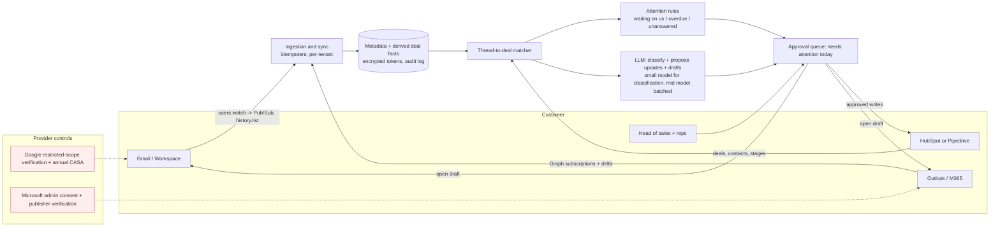

# Segment, wedge, architecture and MVP (deliverables 7-11)

The scores (0-3 per criterion) and the reason for each are in `generated/HYPOTHESES.md`, generated from
`synthesis.py`. A `*` there means the score rests on inference, not a recorded fact. The totals are a summary only:
a 0 on provider policy or on problem severity rejects a hypothesis whatever its total.

## 1. Customer-segment ranking

| Rank | Segment | Total /33 | Status | Deciding reason |
|---|---|---|---|---|
| 1 | **Small B2B teams (3-10 sellers) already paying for a CRM they cannot keep current** | 21 | **Selected** | Most frequent, money-linked pain (E63, E64, E39, E14) and existing spend (E37, E51, E70). The buyer is usually the mail admin. |
| 2 | Founders doing their own sales | 18 | Rejected | Split evenly for and against; free tools and price sensitivity (E59, E7); "a CRM isn't useful until 20-50 customers" (E35). |
| 2 | SDRs / outbound | 18 | Rejected | **Provider policy = 0**: cold outreach through connected Gmail is not an approved use (F9, F40). Spend goes to ESP-like infrastructure (E52, E53). |
| 4 | Consultants | 17 | Rejected | Excel works for them (E56-E58); low frequency. |
| 5 | No-CRM small businesses | 15 | Rejected | The pain found was local-service quotes, not B2B email (E28); no spend signal. |
| 6 | Individual AEs | 13 | Rejected | **Permission = 0**: corporate IT says no (E11, E12, E20); the AE is not the buyer. |
| 7 | Agencies | 12 | Rejected | Under-sampled (3 items); outbound for clients is the excluded cold-email case. |
| — | "CRM laggards" | — | Merged | At 3-10 sellers this is segment 1; in larger companies it is the AE segment. |

**Beachhead persona: "Priya, Head of Sales / sales-led co-founder".**
- **Company:** a B2B company of 15-60 people with 3-10 sellers who sell by email.
- **CRM:** HubSpot (free, Starter or Pro) or Pipedrive.
- **Admin:** she is, or sits next to, the Google Workspace / M365 admin.
- **Routine:** she runs a weekly pipeline review.
- **The problem:** she does not trust the pipeline, because reps update it in batches or not at all (E14, E39), and emails land on the wrong deal (E64).
- **Success for her:** "the CRM is right on Monday morning without nagging anyone."

Why this segment beats the alternatives:
- It is the only one where **pain, existing budget, a reachable single buyer and a self-serve permission path** coincide.
- Its biggest weakness is competition: many such teams say Pipedrive, Close or Copper already work (E37, E73, E40).
- That is why the wedge must complement their CRM rather than compete with it.

## 2. Product hypotheses (wedges)

| Wedge | Total /18 | Status | Why |
|---|---|---|---|
| **CRM upkeep co-pilot** (email activity → approved updates into the existing CRM + "needs attention today") | 9 | **Shortlisted (recommended)** | Biggest pain cluster; no migration; no sending. Risk: HubSpot/Pipedrive native AI. |
| Follow-up accountability layer | 9 | Shortlisted (fallback) | Real lost-deal stories (E27, E28), but **gap = 0**: folk (F179), Superhuman (F166), Gmail nudges (F141, free), Close (F89) already do it, and users fix it with scheduled send (E25). |
| Inbox-to-pipeline (replace the CRM) | 8 | Rejected | Same pain, but asks teams to switch; head-on against Streak, Copper, Day.ai, Lightfield, Clarify; email sync is the costly part (E79). |
| Proposal / negotiation tracker | 8 | Rejected | Only 2 voices; no direct evidence for area G. It becomes a rule in the attention list. |
| Relationship memory | 8 | Rejected | Users who care say notes/Excel work (E17, E58); folk Recap (F180), Day.ai memory (F135). |
| Manager dashboard without CRM hygiene | 7 | Rejected | Voices come from larger companies (E15, E16); for small teams it is an output of the upkeep wedge. |
| Next-best-action assistant | 7 | Rejected | A feature already in Close (F89) and Pipedrive (F174). |
| Lightweight outbound workspace | 7 | Rejected | Policy = 0 (F9, F40, F7); crowded and cheap (F118, F113). |

### Recommended wedge in full: CRM upkeep co-pilot

| Field | Specification |
|---|---|
| Exact customer | Head of sales at a 3-10 seller B2B team on HubSpot or Pipedrive (the persona above). |
| Triggering event | The weekly pipeline review / forecast call reveals stale or wrong deals (E15, E63); or a deal is lost to a forgotten follow-up (E27). |
| Existing workaround | Reps batch-update at the end of the day (E14); managers chase verbal updates (E16); manual deal confirmation (E64); BCC-to-CRM (E75). |
| Intervention | For each open deal, read the linked threads. Propose: correct deal association, stage change, next step + date, follow-up task, close-date change. Manager or rep approves in one click; the app writes to the CRM. Daily list: "customer waiting on us", "promised next step overdue", "no reply after proposal". AI draft for the follow-up, sent by the human from Gmail/Outlook. |
| Expected measurable outcome | Share of open deals with a correct next step and date ≥ 90%; time on CRM upkeep down ≥ 50%; zero deals with an unanswered customer email > 2 business days. These targets are **assumptions to test**. |
| Why current products fail | Auto-CRMs require switching CRM (F135, F164, F194). Native HubSpot sequences need Pro (F149). Native AI accuracy is **unknown**. |
| Required integrations | Gmail API (restricted read) and/or Microsoft Graph (Mail.ReadBasic/Read); HubSpot and Pipedrive APIs (not verified in this pilot). |
| Buyer and purchase | Head of sales or founder, credit card, no procurement. Admin consent given by the same person or a nearby colleague (**inference**). |
| Price range | $99-199 per team per month, flat for ≤ 10 seats (see 05). Anchors: Streak $49/user (F77), folk $48 (F102), Clarify $40 per 3-person team (F193), HubSpot Sales seat $100 (F100). |
| Most serious failure reason | HubSpot/Pipedrive ship the same thing natively (`incumbent-bundling`). Or buyers see it as a discipline problem and won't pay (E33, E61). |
| Path to the broader platform | Approved updates → trusted deal context → human-sent follow-up drafts → in-thread follow-ups to engaged contacts → manager reporting. Cold outreach stays out permanently unless Google clarifies in writing. |

## 3. Architecture comparison

| | A. Secondary dashboard | B. Sales email client | C. Full email-centric workspace | D. AI copilot executing actions | **E. CRM companion (selected)** |
|---|---|---|---|---|---|
| Implementation complexity | Medium | Very high (full client) | Very high (CRM + sync + sequencer) | Medium-high | Medium |
| Provider-permission dependence | Restricted Gmail / M365 admin | Same + full compose | Same + sending policy wall (F9) | Same | Same, plus CRM APIs; possibly avoidable (`crm-logged-email-sufficient`) |
| Ongoing API / infra cost | Low | Medium | Medium | Medium (AI) | Low-medium |
| Security / privacy burden | CASA (F14) | CASA + client security | CASA + sending abuse | CASA + agent safety | CASA (F14) |
| Time to first usable version | 6-10 weeks (**assumption**) | 6+ months | 4-6 months | 8-12 weeks | **0 weeks as concierge; 6-10 weeks as software** |
| Onboarding friction | Another tool (E32) | Replace email client: highest | Replace CRM + client | Trust barrier (E76) | Connect CRM + mailboxes; no behaviour change for reps |
| Risk of being replaced by a CRM feature | High (F141, F179) | High (E78) | High | High (F156, F136) | High: the main risk (F101, F156) |
| Willingness to pay | Unknown | Proven only for Superhuman-type users (E77) | Unknown | Unknown | Unknown |
| Customer acquisition difficulty | Medium | High | High | Medium | Medium; CRM marketplaces are a plausible channel (**unverified**) |
| Long-term defensibility | Low | Low | Low-medium | Low | Low: matching accuracy and trust only |

**Recommendation: E, a narrow form of A + D.** It is the only option that:
- needs no change in where reps work (they stay in Gmail/Outlook) or in the system of record (it stays in their CRM);
- sends nothing in v1;
- can start as a manual service before any provider approval.

## 4. MVP scope with explicit exclusions

**In scope (v1, only after the experiments pass):**
1. Connect one CRM (HubSpot or Pipedrive, whichever dominates in interviews) and N mailboxes (Gmail first or M365 first, decided by `outlook-share`).
2. Link threads to open deals. The match uses participants, domain, `threadId`/`conversationId` and the most recent deal, and asks a human to confirm when unsure.
3. A nightly + real-time "needs attention" list, with three rules: customer waiting on us; promised next step overdue; proposal unanswered for N days.
4. Proposed CRM updates (stage, next step, date, task) with approve / edit / reject; write-back to the CRM; an audit log of every write.
5. An AI follow-up draft opened in the user's own Gmail/Outlook for sending by hand.

**Explicitly excluded:**
- Any sending by the app.
- Sequences, cold outreach, prospect databases, enrichment, warm-up, mailbox rotation.
- A CRM of our own; an email client; shared inboxes.
- Calendar and meeting recording.
- Mobile apps.
- More than one CRM integration at launch.
- Training models on customer mail (F10).

## 5. Architecture diagram and major dependencies

**Major dependencies, ranked by risk:**
1. Google restricted-scope verification + CASA (F14, F18, F23).
2. Microsoft admin consent (F54).
3. CRM API write access and rate limits (**not verified**).
4. LLM API pricing (F198-F200).
5. Pub/Sub (F201).
